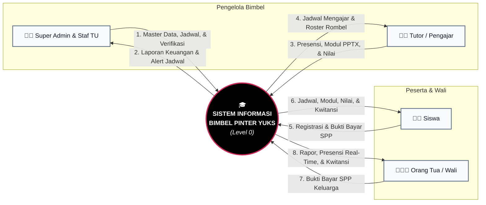
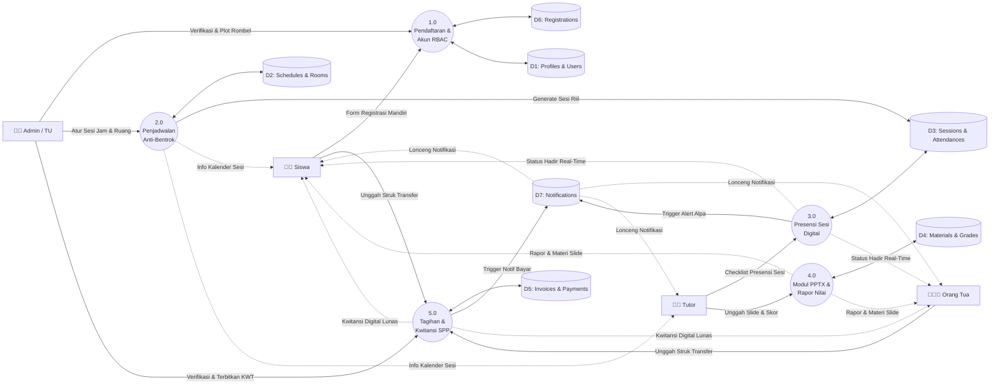
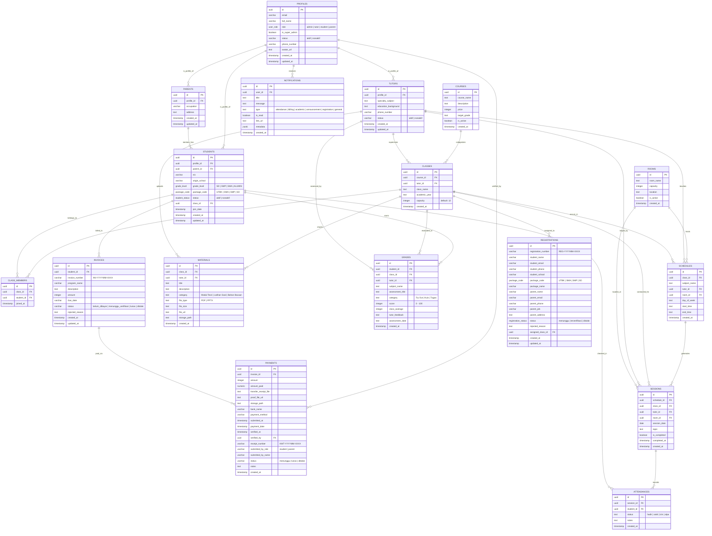
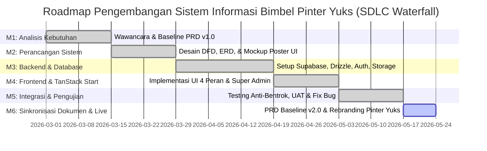

# Product Requirements Document (PRD)

## Sistem Informasi Bimbingan Belajar Berbasis Web — Pinter Yuks

---

### Informasi Dokumen

- **Nama Proyek**: Sistem Informasi Bimbingan Belajar (Bimbel) Berbasis Web
- **Jenama Resmi**: Pinter Yuks
- **Tagline**: *"Pahami Konsepnya, Bukan Sekadar Hafal Rumusnya"*
- **Mata Kuliah**: Rekayasa Perangkat Lunak (RPL)
- **Institusi**: Program Studi S1 Teknik Informatika, Fakultas Teknik, Universitas Tadulako, Palu
- **Penyusun**: Kelompok 3 (Lidiya - F5512530118, Winda Tesalonika - F5512520088, Moh. Yusfi - F5512520089)
- **Tahun Akademik**: 2026
- **Model Pengembangan**: SDLC Waterfall (12 Minggu)
- **Status Dokumen**: Approved & Baseline v2.0 (Tersinkronisasi Penuh dengan Basis Kode Produksi)

---

## 1. Ringkasan Eksekutif & Latar Belakang

### 1.1 Konteks Masalah di Kota Palu

Di Kota Palu, mayoritas operasional lembaga bimbingan belajar (bimbel) konvensional masih dikelola secara manual atau semi-manual:

1. **Pendaftaran Manual & Arsip Tercecer**: Pendaftaran siswa dicatat manual di buku besar fisik atau formulir kertas, menyulitkan pencarian arsip, rentan rusak, dan lambat dalam proses verifikasi tata usaha.
2. **Konflik Jadwal & Perebutan Ruang Belajar**: Penjadwalan les diatur manual melalui grup obrolan percakapan (WhatsApp), sering mengakibatkan **jadwal bentrok** antartutor maupun perebutan ruang belajar fisik.
3. **Distribusi Modul Belajar Tidak Terorganisir**: Modul materi bimbingan dan slide presentasi masih mengandalkan fotokopi fisik atau tautan obrolan yang tersebar tanpa dokumentasi terpusat dan tanpa pratinjau interaktif.
4. **Ketiadaan Transparansi Kehadiran & Nilai bagi Orang Tua**: Orang tua kesulitan memantau kehadiran siswa secara *real-time* (apakah anak benar-benar hadir les atau membolos) serta tidak memiliki akses transparan ke perkembangan nilai belajar dan evaluasi kualitatif tutor.
5. **Penagihan SPP & Kwitansi Konvensional**: Rekap tagihan dan pencatatan pembayaran SPP les masih manual, rawan *human error*, bukti transfer tercecer di galeri ponsel staf, dan kwitansi masih ditulis tangan di atas nota kertas.

### 1.2 Tujuan Produk

Membangun platform sistem informasi berbasis web terpadu (*single-tenant*) untuk lembaga bimbingan belajar **Pinter Yuks** di Kota Palu yang menghubungkan seluruh siklus operasional: **pendaftaran mandiri anti-bot**, **penjadwalan kelas anti-bentrok**, **presensi sesi digital dengan kunci audit 24 jam**, **distribusi materi digital & slide PPTX interaktif**, **rapor evaluasi progres belajar**, dan **verifikasi pembayaran SPP serta penerbitan kwitansi digital resmi** secara transparan.

---

## 2. Arsitektur Teknologi & Tech Stack

Sistem dibangun dengan standar arsitektur web modern *full-stack type-safe*:

### 2.1 Frontend & Rendering Engine
- **Framework Web Full-stack**: [TanStack Start](https://tanstack.com/start) (React 19, Type-Safe Routing, Server Functions via `createServerFn`).
- **Arsitektur Rendering Terisolasi**:
  - Halaman Publik (`/`, `/metode/*`): **Server-Side Rendering (SSR)** untuk optimasi SEO dan pemuatan awal kilat.
  - Portal Aplikasi & Dashboard (`/admin/*`, `/tutor/*`, `/student/*`, `/parent/*`): **Client-Side Rendering (CSR, `ssr: false`)** untuk performa interaktif tinggi dan keamanan sesi.
- **State Management & Caching**: [TanStack Query v5](https://tanstack.com/query) (pengelolaan server-state, invalidasi cache reaktif, dan mutasi optimistik).
- **Data Presentation & Grid**: [TanStack Table v8](https://tanstack.com/table) (Filter, Sorting, dan Pagination server-side pada data siswa, rombel, jadwal, nilai, dan tagihan).
- **Komponen UI**: **Base UI (`@base-ui/react` v1.9)** berbalut pola desain headless shadcn via utility `cn()`. Bebas dari ketergantungan wrapper Radix UI usang demi kepatuhan performa React 19 Compiler.
- **Styling**: [Tailwind CSS v4](https://tailwindcss.com/) dengan palet *Poster Kontras Tinggi* (`#000000`, `#CB2957`, `#EEEEEE`). Tipografi: **Archivo** (Display/Heading) dan **Instrument Sans** (Body/Form/Tabel).
- **Penampil Presentasi Interaktif**: [`@extend-ai/react-pptx`](https://github.com) untuk render pratinjau slide modul presentasi PPTX langsung di dalam peramban tanpa mengunduh berkas fisik.

### 2.2 Backend, Database & Infrastruktur Cloud
- **Platform BaaS**: [Supabase](https://supabase.com/)
  - **Database Hosting**: PostgreSQL (Relational Database dengan Composite Indexing dan Foreign Keys terindeks).
  - **Autentikasi & RBAC**: Supabase Auth (Email & Password dengan isolasi sesi 4 peran dan instan token revocation untuk akun nonaktif).
  - **Row-Level Security (RLS)**: Penegakan aturan akses data level baris pada database.
  - **Object Storage**: Supabase Storage Buckets:
    - `receipts`: Repositori penyimpanan foto struk bukti transfer SPP dari siswa dan orang tua.
    - `learning-materials`: Repositori berkas modul belajar resmi (PDF & PPTX).
    - `avatars`: Foto profil pengguna.
  - **Realtime Engine**: Supabase Realtime (In-App Notification broadcast lonceng waktu-nyata).
- **Database Schema Management & Migrations**: [Drizzle ORM](https://orm.drizzle.team/) (`drizzle-orm` v0.45 + `postgres.js`).
  - Seluruh skema tabel didefinisikan secara *code-first type-safe* di `src/db/schema/*`.
  - Migrasi basis data terkelola otomatis via Drizzle Kit (`npm run db:generate` & `npm run db:push`) ke folder `drizzle/*.sql`.
  - Inferensi tipe TypeScript otomatis (`Profile`, `Student`, `Session`, `Invoice`, dll.) sebagai Single Source of Truth (SSOT).
- **Keamanan & Proteksi Form Pendaftaran**: [Cloudflare Turnstile](https://www.cloudflare.com/products/turnstile/) untuk validasi CAPTCHA anti-bot/spam non-intrusif pada formulir pendaftaran siswa publik.
- **Notifikasi Dorong**: Web Push API (`web-push`) & Service Worker untuk pemberitahuan peramban.

---

## 3. Matriks Peran Pengguna (User Roles & Permissions)

Sistem memiliki 4 aktor pengguna utama dengan hak akses terisolasi (RBAC), ditambah pemisahan tingkat kewenangan administratif internal:

| Peran (Role) | Deskripsi Utama | Hak Akses Fitur Utama |
| :--- | :--- | :--- |
| **Super Admin** *(Pimpinan / Kepala Cabang)* | Pemegang otoritas tertinggi tata kelola lembaga Pinter Yuks | - Seluruh hak akses Admin. - Kelola Akun Staf Tata Usaha (`/admin/staf`): tambah staf baru, ubah kontak, dan aktif/nonaktifkan akun staf. - Tinjauan menyeluruh laporan keuangan agregat dan pengawasan seluruh rombel. |
| **Admin** *(Staf Tata Usaha)* | Pengelola operasional harian bimbingan belajar | - Verifikasi Formulir Pendaftaran Siswa Baru & Penetapan Rombel (*Class Plotting*). - Kelola Master Data (Siswa, Tutor, Orang Tua, Ruangan, Program Belajar, Rombel Kelas). - Manajemen Jadwal Bimbingan Mingguan dengan Engine Anti-Bentrok. - Penerbitan Tagihan SPP, Verifikasi Bukti Bayar, & Penerbitan Kwitansi Digital Resmi. - Siaran Pengumuman Lembaga ke Seluruh Pengguna Terdaftar. |
| **Tutor (Pengajar)** | Tenaga pendidik bimbingan belajar | - Akses Jadwal Mengajar Pribadi mingguan/harian. - Checklist Presensi Sesi Digital dengan Grace Period koreksi 24 jam. - Unggah Modul Pelajaran (PDF) dan Slide Presentasi Interaktif (PPTX). - Input Nilai Evaluasi (Try Out, Kuis, Tugas) dengan kalkulasi rata-rata rombel otomatis dan catatan kualitatif. |
| **Siswa** | Peserta bimbingan belajar terdaftar | - Akses Jadwal Bimbingan Mingguan pribadi. - Pratinjau Interaktif & Unduh Modul Belajar (PDF & PPTX). - Pantau Riwayat Presensi & Persentase Kehadiran Belajar. - Lihat Rekap Nilai Evaluasi & Catatan Umpan Balik Tutor. - Portal Tagihan SPP: Cek tagihan, unggah bukti transfer, & unduh kwitansi lunas resmi. |
| **Orang Tua / Wali** | Wali murid dari satu atau lebih siswa | - **Multi-Child Switcher**: Ganti profil anak aktif dengan 1 klik tanpa *logout*. - Pantau Kehadiran Anak Waktu-Nyata (*Hadir/Sakit/Izin/Alpa*) dengan alert visual jika Alpa. - Rapor Progres Nilai & Catatan Perkembangan Anak per Mata Pelajaran. - Portal Tagihan SPP Keluarga: Unggah bukti transfer atas nama anak & unduh kwitansi digital. |

---

## 4. Kebutuhan Fungsional & Kriteria Akseptasi (Spesifikasi Fitur)

### 4.1 Modul Autentikasi, Akun & Pendaftaran (AUTH)

- **AUTH-01: Registrasi Calon Siswa Mandiri & Proteksi Anti-Bot**
  - *User Story*: Sebagai calon siswa atau orang tua, saya ingin mendaftar secara daring lewat modal registrasi web dengan mengisi data diri lengkap, data wali, serta pilihan paket bimbingan (SD/SMP/SMA/UTBK) agar proses admisi praktis dan tercatat rapi.
  - *Kriteria Akseptasi*:
    - Formulir dilindungi verifikasi Cloudflare Turnstile anti-bot sebelum data dikirim.
    - Sistem memvalidasi keunikan email dan nomor telepon.
    - Data tersimpan di tabel `registrations` dengan status awal `menunggu` dan nomor registrasi unik (`REG-YYYYMM-XXXX`).
    - Staf Tata Usaha dapat menyetujui pendaftaran dan langsung menetapkan siswa ke Rombel Kelas aktif (*Class Plotting*) yang memiliki kuota kursi tersedia (maksimal 12 siswa).
    - Persetujuan pendaftaran secara otomatis membuat akun di `profiles`, `students`, relasi `parents`, serta menerbitkan Nomor Induk Siswa (NIS) unik (`PNT-YYYY-XXXX`).
    - Jika ditolak, sistem mencatat alasan penolakan (`rejected_reason`) transparan.
- **AUTH-02: Role-Based Dashboard Redirection & Session Revocation**
  - *Kriteria Akseptasi*:
    - Pengguna masuk melalui rute resmi `/masuk`.
    - Setelah autentikasi sukses, sistem mengarahkan pengguna secara otomatis ke rute dashboard sesuai perannya: `/admin`, `/tutor`, `/student`, atau `/parent`.
    - Jika akun pengguna dinonaktifkan oleh Admin (`status = 'nonaktif'`), sesi peramban otomatis dicabut seketika (*instant session revocation*) dan diarahkan kembali ke `/masuk` dengan peringatan error yang jelas.

### 4.2 Modul Penjadwalan Bimbingan Anti-Bentrok (SCHED)

- **SCHED-01: Manajemen Master Ruangan, Program & Rombel Kelas**
  - Admin dapat mendefinisikan ruang fisik (misal: Ruang Pinter 1, Ruang Palu-1) beserta kapasitas maksimal kursi (10–12 siswa).
  - Admin dapat membentuk rombongan belajar (*classes*) yang terikat pada paket program belajar dan wali tutor penanggung jawab.
- **SCHED-02: Conflict Detection Engine & Overdue Protection**
  - *Logika Validasi Anti-Bentrok*:
    - **Bentrok Ruangan**:
      $$\text{Bentrok Ruang} \iff (\text{Ruangan}_A = \text{Ruangan}_B) \land (\text{Hari}_A = \text{Hari}_B) \land (\text{Mulai}_A < \text{Selesai}_B) \land (\text{Selesai}_A > \text{Mulai}_B)$$
    - **Bentrok Tutor**:
      $$\text{Bentrok Tutor} \iff (\text{Tutor}_A = \text{Tutor}_B) \land (\text{Hari}_A = \text{Hari}_B) \land (\text{Mulai}_A < \text{Selesai}_B) \land (\text{Selesai}_A > \text{Mulai}_B)$$
  - *Kriteria Akseptasi*:
    - Deteksi bentrok dieksekusi di *service layer* sebelum operasi penyimpanan ke tabel `schedules`.
    - Jika terjadi bentrok, sistem memblokir penyimpanan dan menampilkan pesan error spesifik yang menyebutkan nama sesi, jam, dan tutor/ruangan yang bertabrakan.
    - Sistem menghasilkan entri sesi aktual di tabel `sessions` berdasarkan jadwal berulang mingguan.
    - **Proteksi Sesi Lampau (*Overdue Protection*)**: Pembaruan jadwal mingguan oleh Admin tidak boleh menggeser atau menghapus sesi lampau yang belum tervalidasi (`is_completed = false` dan `session_date < today`), guna menjaga keaslian arsip kehadiran historis.

### 4.3 Modul Presensi Sesi Digital (ATTEND)

- **ATTEND-01: Checklist Presensi Sesi Aktual oleh Tutor & Kunci Audit 24 Jam**
  - *User Story*: Sebagai Tutor, saat kelas dimulai, saya ingin membuka sesi bimbingan hari ini dan mencatat kehadiran siswa rombel secara digital agar data kehadiran tersimpan permanen di database.
  - *Kriteria Akseptasi*:
    - Presensi dicatat pada entitas pertemuan nyata di tabel `sessions` dan status individual di tabel `attendances`.
    - Pilihan status semantik per siswa: `hadir`, `sakit`, `izin`, `alpa`.
    - Dilengkapi tombol cepat *"Hadirkan Semua Siswa"* dan kolom topik materi pembahasan sesi.
    - **Kunci Audit & Grace Period 24 Jam**: Tutor diberikan toleransi koreksi salah klik selama 24 jam sejak sesi dinyatakan selesai (`is_completed = true`). Melewati 24 jam, lembar presensi otomatis terkunci permanen (*read-only*) bagi Tutor demi keaslian data audit.
- **ATTEND-02: Pemantauan Kehadiran Real-time & Peringatan Alpa**
  - *Kriteria Akseptasi*:
    - Dashboard Siswa dan Orang Tua langsung menampilkan status kehadiran seketika setelah tutor menyimpan presensi.
    - Persentase kehadiran dihitung secara deterministik:
      $$\text{Persentase Kehadiran} = \frac{\text{Jumlah Sesi Hadir}}{\text{Total Sesi Selesai}} \times 100\%$$
    - Jika siswa tercatat `alpa`, sistem otomatis mengirimkan peringatan visual dan notifikasi lonceng ke akun Orang Tua.

### 4.4 Modul Pembelajaran & Rapor Progres (LEARN)

- **LEARN-01: Manajemen Modul Digital & Pratinjau Slide Presentasi Interaktif**
  - Tutor dapat mengunggah berkas modul resmi berformat PDF atau presentasi interaktif PPTX (maksimal 20MB) ke bucket Supabase Storage `learning-materials`.
  - Siswa rombel terkait dapat mengunduh berkas atau membuka pratinjau slide presentasi interaktif langsung di dalam web menggunakan `@extend-ai/react-pptx`.
- **LEARN-02: Input Nilai Evaluasi & Kalkulasi Rata-Rata Rombel Otomatis**
  - Tutor dapat menginput nilai hasil bimbingan: Mata Pelajaran, Judul Evaluasi (misal: "Try Out 1 UTBK TPS"), Kategori (`Try Out` / `Kuis` / `Tugas`), Skor (0–100), dan Catatan Kualitatif Tutor.
  - Sistem secara otomatis menghitung dan menyimpan rata-rata nilai kelas (`class_average`) pada saat entri dibuat untuk perbandingan performa belajar siswa.
- **LEARN-03: Rapor Progres Belajar Orang Tua & Siswa**
  - Halaman rapor menampilkan grafik tren nilai, riwayat evaluasi per mata pelajaran, dan komparasi skor siswa terhadap rata-rata rombel kelas.

### 4.5 Modul Manajemen Pembayaran SPP (BILL)

- **BILL-01: Penerbitan Tagihan SPP Resmi oleh Tata Usaha**
  - Admin membuat tagihan biaya bimbingan untuk siswa terdaftar.
  - Nomor tagihan distandarisasi otomatis: `INV-YYYYMM-XXXX`.
  - Status awal tagihan: `belum_dibayar`.
- **BILL-02: Pengunggahan Bukti Transfer oleh Siswa / Orang Tua**
  - Siswa atau Orang Tua dapat mengunggah foto struk bukti transfer bank (JPG, PNG, PDF maks 5MB) ke bucket Supabase Storage `receipts`.
  - Sistem mencatat rekaman riwayat pembayaran di tabel `payments` (nama bank, metode bayar, nama pengunggah, tanggal).
  - Status tagihan bertransisi otomatis menjadi `menunggu_verifikasi` (menunggu).
- **BILL-03: Verifikasi Admin, Penolakan Transparan & Penerbitan Kwitansi Digital**
  - Administrator meninjau berkas bukti transfer via dialog pratinjau (*in-app preview*).
  - **Persetujuan (Approve)**:
    - Status tagihan dan pembayaran berubah menjadi `lunas`.
    - Sistem mencatat profil verifikator serta tanggal verifikasi WITA.
    - Sistem secara otomatis menerbitkan Nomor Kwitansi Resmi unik: `KWT-YYYYMM-XXXX`.
  - **Penolakan (Reject)**:
    - Status berubah menjadi `ditolak` disertai pencatatan alasan penolakan resmi (`rejected_reason`).
    - Siswa dan orang tua dapat membaca alasan penolakan dan mengunggah ulang bukti bayar yang benar.
  - Tagihan yang telah lunas menyediakan tombol cetak/unduh lembar Kwitansi Digital Resmi berstempel Pinter Yuks lengkap dengan nomor kwitansi, rincian biaya, dan tanda tangan digital tata usaha.

### 4.6 Modul Notifikasi Waktu-Nyata (NOTIF)

- Notifikasi lonceng in-app pada antarmuka web (tabel `notifications`) dan Web Push Notification untuk:
  - Pembayaran diverifikasi (`lunas`) atau ditolak.
  - Catatan absensi `alpa` untuk akun Orang Tua.
  - Modul belajar baru diunggah oleh tutor.
  - Pengumuman resmi lembaga yang disiarkan oleh Administrator.

---

## 5. Diagram Alir Data (Data Flow Diagram / DFD)

### 5.1 Diagram Konteks (DFD Level 0)

Diagram Konteks menggambarkan batasan sistem (*system boundary*) Pinter Yuks dengan tata letak horizontal terisolasi:

### 5.2 DFD Level 1 (Dekomposisi 5 Proses Operasional & 7 Data Stores)

---

## 6. Perancangan Basis Data (Entity Relationship Diagram / ERD)

Skema relasional PostgreSQL di Supabase yang dikelola secara type-safe via Drizzle ORM (17 Tabel):

---

## 7. Kebutuhan Non-Fungsional (Non-Functional Requirements / NFR)

1. **Keamanan (Security)**:
   - Komunikasi seluruh lapisan sistem wajib HTTPS/TLS dengan header HSTS.
   - Proteksi otorisasi ganda: Middleware Server Functions TanStack Start (`createServerFn`) di sisi backend dan PostgreSQL Row-Level Security (RLS) di sisi basis data.
   - Proteksi bot cerdas menggunakan token Cloudflare Turnstile pada rute registrasi publik.
   - Pengecekan status akun aktif (`status = 'aktif'`) pada setiap transaksi kritis untuk mencegah aksi dari akun yang telah dibekukan.
2. **Kinerja & Skalabilitas (Performance)**:
   - Waktu muat awal (*First Contentful Paint*) halaman landing publik di bawah 1.5 detik pada koneksi internet seluler standar Kota Palu melalui Server-Side Rendering (SSR).
   - Optimasi kueri dengan composite indexes pada tabel relasi padat (`sessions`, `attendances`, `grades`, `invoices`, `notifications`).
   - Paginasi dan penyaringan sisi server (*server-side pagination*) via TanStack Table untuk menangani ratusan baris data siswa dan riwayat transaksi secara mulus.
3. **Usabilitas & Aksesibilitas (UI/UX)**:
   - Pendekatan desain *Poster Kontras Tinggi* yang bersih, tegas, dan mudah dibaca oleh berbagai kalangan usia (termasuk orang tua).
   - Antarmuka responsif ramah seluler (*mobile-first*) dengan Base UI dan Tailwind CSS v4.
   - Indikator status semantik inline tanpa border/badge palsu berlebihan sesuai standar profesional `AGENTS.md`.
4. **Keandalan & Integritas Data (Data Integrity)**:
   - Transaksi multi-tabel (pendaftaran siswa, verifikasi bayar, pembuatan sesi) wajib dibungkus dalam blok atomik database untuk mencegah data korup (*orphaned rows*).
   - Penegakan integritas jadwal anti-bentrok secara otomatis pada tingkat kode service sebelum penyimpanan.

---

## 8. Milestone & Pemetaan SDLC Waterfall (12 Minggu)

Mengacu pada linimasa pengembangan proyek rekayasa perangkat lunak:

| Milestone | Kegiatan Utama | Durasi | Luaran (Deliverables) |
| :--- | :--- | :--- | :--- |
| **M1** (Minggu 1-2) | Analisis Kebutuhan | 2 Minggu | Dokumen PRD / SRS awal disetujui tim & dosen |
| **M2** (Minggu 3-4) | Perancangan Sistem | 2 Minggu | Diagram DFD Level 0 & 1, Skema ERD Awal, Design System |
| **M3** (Minggu 5-7) | Backend & Database | 3 Minggu | PostgreSQL DB Supabase, Skema Drizzle ORM, RLS, Storage Buckets |
| **M4** (Minggu 8-9) | Frontend TanStack | 2 Minggu | Halaman Web Responsif untuk 4 Peran Pengguna + Super Admin |
| **M5** (Minggu 10-11) | Integrasi & Uji Sistem | 2 Minggu | Verifikasi Anti-bentrok, Grace Period Presensi, End-to-End Test |
| **M6** (Minggu 12) | Finalisasi & Rebranding | 1 Minggu | Aplikasi live Pinter Yuks, PRD Baseline v2.0 tersinkronisasi penuh |

---

## 9. Penataan Berkas DFD Pendukung

Seluruh berkas diagram aliran data pendukung telah diselaraskan pada direktori `dfd/`:

- `dfd/context_diagram.md`: Diagram Konteks Level 0 entitas Pinter Yuks beserta narasi aliran data.
- `dfd/dfd_level_1.md`: Dekomposisi proses 1.0 s/d 5.0 beserta kamus data 7 data stores.
- `dfd/dfd_level_2.md`: Dekomposisi sub-proses detail (1.x s/d 5.x) bebas garis bertumpuk.
