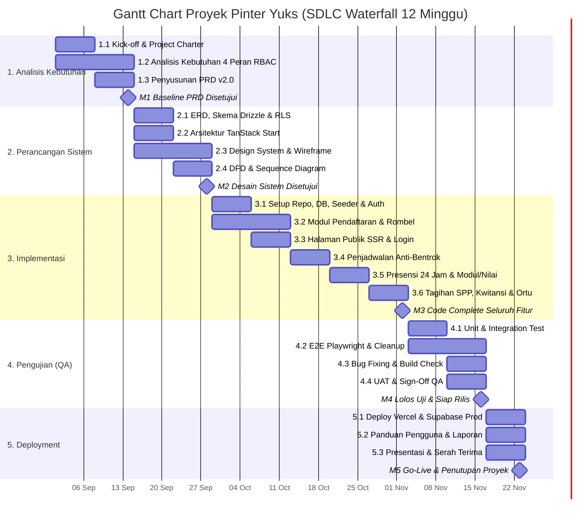

# Project Plan — Sistem Informasi Bimbingan Belajar (Pinter Yuks)

**Mata Kuliah**: Rekayasa Perangkat Lunak (RPL)  
**Institusi**: Program Studi S1 Teknik Informatika, Fakultas Teknik, Universitas Tadulako  
**Model Pengembangan**: SDLC Waterfall (12 Minggu)  
**Periode Proyek**: 1 September 2026 – 23 November 2026  
**File Excel Pendamping (Demonstrasi)**: [Project_Plan_Pinter_Yuks.xlsx](file:///C:/Users/ggwpy/project-tugas-untad/pintar_yuks/docs/Project_Plan_Pinter_Yuks.xlsx)

---

## 1. Struktur Tim & Pembagian Peran

| No | Nama Anggota | NIM | Peran (Role) | Tanggung Jawab Utama |
| :--- | :--- | :--- | :--- | :--- |
| 1 | **Moh Yusfi Lakhafidun** | F5512520089 | Project Manager & Lead Full-Stack / System Architect | Koordinasi tim, arsitektur TanStack Start, modul jadwal anti-bentrok, deployment produksi, pemantauan EVM. |
| 2 | **Ilham Arifin** | F5512530109 | Backend & Database Engineer | Skema Drizzle ORM, migrasi PostgreSQL, Supabase Auth/RBAC, RLS, Server Functions, integrasi Storage/Realtime. |
| 3 | **Akhsan Maulana R** | F5512530114 | Frontend Engineer (Publik SSR & Admin/Tutor) | Halaman publik SSR (`/`, `/program`, `/faq`), dashboard tata usaha (`/admin/*`) dan pengajar (`/tutor/*`). |
| 4 | **Nefaldi** | F5512520082 | Frontend & UI/UX Engineer (Siswa/Ortu & Design System) | Design System *Poster Kontras Tinggi*, wireframe, dashboard siswa (`/student/*`) & orang tua (`/parent/*`). |
| 5 | **Alifias** | F5512520099 | QA Engineer & Technical Writer | Pengujian unit/integrasi & E2E Playwright, UAT, penyusunan PRD, DFD, Sequence Diagram, dan Project Plan. |

---

## 2. Dokumentasi Asumsi Proyek

Seluruh jadwal, estimasi usaha, dan anggaran biaya pada dokumen ini disusun berdasarkan asumsi berikut:

1. **Horizon Waktu & Model SDLC**: Menggunakan model **SDLC Waterfall 12 Minggu** terhitung mulai **1 September 2026** hingga **23 November 2026** (12 minggu kalender penuh).
2. **Kapasitas Kerja Mahasiswa**: Setiap anggota diasumsikan bekerja secara *part-time* akademik sebesar **12 jam/minggu** (total kapasitas tim = **60 jam/minggu**, atau maksimal **720 Man-Hours** selama 12 minggu). Total alokasi WBS direncanakan **672 Man-Hours** (utilisasi 93,3%) agar tersedia *buffer* 48 jam untuk koordinasi dan revisi minor.
3. **Standar Tarif Simulasi Tenaga Kerja**: Menggunakan tarif simulasi *Junior Software Developer / Freelance* di Indonesia sebesar **Rp 50.000 / jam** untuk seluruh peran agar estimasi biaya proyek tetap objektif dan dapat dipertanggungjawabkan secara profesional.
4. **Infrastruktur & Layanan Cloud (Masa Pengembangan 3 Bulan)**:
   - **Supabase** (PostgreSQL, Auth, Storage, Realtime): **Rp 0** (*Free Tier*, batas 500 MB DB & 1 GB Storage memadai untuk pengembangan dan UAT).
   - **Vercel** (Hosting TanStack Start SSR/CSR): **Rp 0** (*Hobby/Free Tier*).
   - **Cloudflare Turnstile** (Anti-Bot Pendaftaran): **Rp 0** (*Free Tier*).
   - **Domain Kustom (`.com` / `.my.id`)**: **Rp 200.000** (registrasi 1 tahun untuk keperluan demonstrasi produksi).
   - **Biaya Operasional Internet & Perangkat Tim**: **Rp 1.500.000** (5 anggota × Rp 100.000/bulan × 3 bulan).
5. **Cadangan Risiko (*Contingency Reserve*)**: Dialokasikan sebesar **15%** dari *Base Cost* (Tenaga Kerja + Infrastruktur) untuk mengantisipasi dampak risiko teknis maupun non-teknis pada *Risk Register*.
6. **Ketergantungan Ruang Lingkup (*Baseline*)**: Fitur mengacu pada [PRD.md](file:///C:/Users/ggwpy/project-tugas-untad/pintar_yuks/PRD.md) v2.0 (4 peran terisolasi, anti-bentrok jadwal, presensi kunci 24 jam, modul PPTX/PDF, dan tagihan SPP). Perubahan fitur di luar baseline setelah Milestone M1 memerlukan *Change Request*.

---

## 3. Work Breakdown Structure (WBS) & Gantt Chart (12 Minggu)

### 3.1 Ringkasan WBS & Jadwal Mingguan

| Kode | Fase / Paket Pekerjaan | PIC | Durasi | Mulai | Selesai | Usaha (Jam) | W1 | W2 | W3 | W4 | W5 | W6 | W7 | W8 | W9 | W10 | W11 | W12 |
| :--- | :--- | :--- | :--- | :--- | :--- | :---: | :-: | :-: | :-: | :-: | :-: | :-: | :-: | :-: | :-: | :-: | :-: | :-: |
| **1** | **Inisiasi & Analisis Kebutuhan** | | **2 Mgg** | **01 Sep** | **14 Sep** | **104** | | | | | | | | | | | | |
| 1.1 | Kick-off, Project Charter & Identifikasi Masalah Bimbel | Moh Yusfi | 1 Mgg | 01 Sep | 07 Sep | 16 | █ | | | | | | | | | | | |
| 1.2 | Analisis Kebutuhan Fungsional & Non-Fungsional (4 Peran RBAC) | Moh Yusfi, Alifias | 2 Mgg | 01 Sep | 14 Sep | 32 | █ | █ | | | | | | | | | | |
| 1.3 | Penyusunan Dokumen PRD v2.0 & Kriteria Akseptasi | Alifias, Moh Yusfi | 1 Mgg | 08 Sep | 14 Sep | 32 | | █ | | | | | | | | | | |
| 1.4 | Review & Persetujuan Baseline PRD (**M1**) | Moh Yusfi, Alifias | 1 Mgg | 08 Sep | 14 Sep | 24 | | █ | | | | | | | | | | |
| **2** | **Perancangan Sistem & UI/UX** | | **2 Mgg** | **15 Sep** | **28 Sep** | **112** | | | | | | | | | | | | |
| 2.1 | Perancangan ERD, Skema Drizzle ORM & Kebijakan RLS | Ilham Arifin | 1 Mgg | 15 Sep | 21 Sep | 28 | | | █ | | | | | | | | | |
| 2.2 | Perancangan Arsitektur Sistem (TanStack Start SSR/CSR) | Moh Yusfi, Ilham | 1 Mgg | 15 Sep | 21 Sep | 24 | | | █ | | | | | | | | | |
| 2.3 | Perancangan Design System (*Poster Kontras Tinggi*) & Wireframe | Nefaldi, Akhsan | 2 Mgg | 15 Sep | 28 Sep | 36 | | | █ | █ | | | | | | | | |
| 2.4 | Penyusunan DFD, Sequence Diagram & Review Desain (**M2**) | Alifias, Moh Yusfi | 1 Mgg | 22 Sep | 28 Sep | 24 | | | | █ | | | | | | | | |
| **3** | **Implementasi / Pengembangan** | | **5 Mgg** | **29 Sep** | **02 Nov** | **288** | | | | | | | | | | | | |
| 3.1 | Setup Repo, Migrasi DB, Seeder & Supabase Auth/RBAC | Ilham, Moh Yusfi | 1 Mgg | 29 Sep | 05 Okt | 48 | | | | | █ | | | | | | | |
| 3.2 | Modul Pendaftaran (Turnstile) & Plotting Rombel | Ilham, Akhsan | 2 Mgg | 29 Sep | 12 Okt | 48 | | | | | █ | █ | | | | | | |
| 3.3 | Halaman Publik SSR (`/`, `/program`, `/faq`) & Login | Akhsan, Nefaldi | 1 Mgg | 06 Okt | 12 Okt | 36 | | | | | | █ | | | | | | |
| 3.4 | Modul Penjadwalan Anti-Bentrok & Dashboard Admin/Tutor | Moh Yusfi, Akhsan | 1 Mgg | 13 Okt | 19 Okt | 48 | | | | | | | █ | | | | | |
| 3.5 | Modul Presensi Digital (Kunci 24 Jam) & Modul/Nilai | Ilham, Nefaldi | 1 Mgg | 20 Okt | 26 Okt | 56 | | | | | | | | █ | | | | |
| 3.6 | Modul Tagihan SPP, Kwitansi Digital & Multi-Child Parent (**M3**) | Nefaldi, Akhsan, Ilham | 1 Mgg | 27 Okt | 02 Nov | 52 | | | | | | | | | █ | | | |
| **4** | **Pengujian & Penjaminan Mutu (QA)** | | **2 Mgg** | **03 Nov** | **16 Nov** | **112** | | | | | | | | | | | | |
| 4.1 | Pengujian Unit & Integrasi Service Layer (Anti-Bentrok, Kuota) | Alifias, Ilham | 1 Mgg | 03 Nov | 09 Nov | 36 | | | | | | | | | | █ | | |
| 4.2 | Pengujian End-to-End (Playwright) 4 Peran & Cleanup Data Uji | Alifias, Moh Yusfi | 2 Mgg | 03 Nov | 16 Nov | 40 | | | | | | | | | | █ | █ | |
| 4.3 | Perbaikan Bug (*Bug Fixing*), Typecheck & Build Verification | Akhsan, Nefaldi, Ilham | 1 Mgg | 10 Nov | 16 Nov | 24 | | | | | | | | | | | █ | |
| 4.4 | User Acceptance Testing (UAT) & Sign-Off QA (**M4**) | Alifias | 1 Mgg | 10 Nov | 16 Nov | 12 | | | | | | | | | | | █ | |
| **5** | **Deployment & Penutupan Proyek** | | **1 Mgg** | **17 Nov** | **23 Nov** | **56** | | | | | | | | | | | | |
| 5.1 | Deployment ke Vercel & Konfigurasi Supabase Produksi | Moh Yusfi, Ilham | 1 Mgg | 17 Nov | 23 Nov | 20 | | | | | | | | | | | | █ |
| 5.2 | Penyusunan Panduan Pengguna, Script Demo & Laporan Akhir | Alifias, Nefaldi | 1 Mgg | 17 Nov | 23 Nov | 24 | | | | | | | | | | | | █ |
| 5.3 | Presentasi Final, Demonstrasi & Serah Terima (**M5**) | Semua Anggota | 1 Mgg | 17 Nov | 23 Nov | 12 | | | | | | | | | | | | █ |

### 3.2 Visualisasi Gantt Chart (Mermaid)

---

## 4. Daftar Milestone (*Project Milestones*)

| ID | Nama Milestone | Target Tanggal | Minggu | Kriteria Kelulusan (*Deliverable / Exit Criteria*) | Penanggung Jawab |
| :--- | :--- | :--- | :---: | :--- | :--- |
| **M1** | **Baseline PRD Disetujui** | 14 Sep 2026 | W2 | Dokumen PRD v2.0 ditandatangani tim; seluruh user story 4 peran & kriteria akseptasi terkunci. | Moh Yusfi & Alifias |
| **M2** | **Desain Sistem & UI/UX Disetujui** | 28 Sep 2026 | W4 | ERD, skema Drizzle, DFD, Sequence Diagram, dan mockup *Poster Kontras Tinggi* selesai direview. | Ilham, Nefaldi, Alifias |
| **M3** | **Code Complete (Fitur Inti Selesai)** | 02 Nov 2026 | W9 | Seluruh modul (Auth, Rombel, Anti-Bentrok, Presensi 24 Jam, Modul/Nilai, SPP) terintegrasi ke Supabase. | Moh Yusfi |
| **M4** | **QA Sign-Off & UAT Lulus** | 16 Nov 2026 | W11 | `npm run typecheck` & `npm run build` bebas error, 0 bug kritis/blocker, suite Playwright E2E lulus 100%. | Alifias |
| **M5** | **Go-Live & Penutupan Proyek** | 23 Nov 2026 | W12 | Aplikasi ter-deploy di Vercel dengan domain aktif, laporan akhir & video/demonstrasi proyek selesai. | Semua Anggota |

---

## 5. Risk Register & Rencana Mitigasi

Skala penilaian: **Probabilitas (P)** `1 (Sangat Rendah) – 5 (Sangat Tinggi)`, **Dampak (D)** `1 – 5`, **Skor Risiko = P × D** (`>= 15` Tinggi, `8–14` Sedang, `< 8` Rendah).

| ID | Kategori | Deskripsi Risiko | P | D | Skor | Level | Strategi Mitigasi | Rencana Kontingensi (Jika Terjadi) | Pemilik Risiko |
| :--- | :--- | :--- | :---: | :---: | :---: | :---: | :--- | :--- | :--- |
| **R-01** | Teknis | Bug logika deteksi bentrok jadwal (ruang/tutor) atau kuota rombel (>12 siswa) pada concurrent request. | 3 | 5 | **15** | Tinggi | Validasi ganda di *service layer* dalam `db.transaction()` dan tulis unit test khusus skenario irisan waktu. | Rollback transaksi otomatis dan tampilkan pesan konflik spesifik; tambahkan *unique constraint* di DB. | Ilham Arifin |
| **R-02** | Teknis | Kebocoran data antar peran karena konfigurasi *Row-Level Security* (RLS) Supabase atau Server Function tidak ketat. | 2 | 5 | **10** | Sedang | Wajibkan validasi role & session pada setiap `createServerFn` serta audit kebijakan RLS sebelum fase QA. | Cabut sesi aktif (*instant revocation*) dan perketat policy RLS pada tabel sensitif (`invoices`, `grades`). | Ilham Arifin |
| **R-03** | Teknis | Kendala integrasi pihak ketiga (Cloudflare Turnstile gagal render di lokal/preview atau batas *free tier* Supabase Storage). | 3 | 3 | **9** | Sedang | Gunakan *test site key* Turnstile untuk environment lokal/staging dan batasi ukuran upload bukti bayar/modul (<5 MB). | Sediakan *fallback environment flag* pada mode dev dan kompresi gambar di sisi klien sebelum upload. | Moh Yusfi |
| **R-04** | Jadwal | Keterlambatan penyelesaian fase Implementasi (W5–W9) karena bentrok jadwal kuliah/UTS anggota tim. | 4 | 4 | **16** | Tinggi | Pecah modul paralel antar 5 anggota, lakukan *weekly sync* 15 menit tiap Senin, dan pantau SPI mingguan. | Alihkan sebagian jam kerja *buffer* (48 jam) atau realokasi tugas dari anggota yang modulnya selesai lebih awal. | Moh Yusfi |
| **R-05** | Kualitas | Data uji otomatis (Playwright/Vitest) tertinggal di database Supabase development/staging sehingga mengotori data demo. | 3 | 4 | **12** | Sedang | Terapkan hook `afterAll`/`afterEach` wajib hapus data uji sesuai aturan proyek dan pisahkan akun demo dari akun uji. | Jalankan skrip `[CLEANUP]` dan re-seed database menggunakan `src/db/seed.ts`. | Alifias |
| **R-06** | Scope | *Scope creep* (permintaan penambahan fitur baru di luar PRD v2.0 setelah minggu ke-4). | 3 | 4 | **12** | Sedang | Kunci baseline fitur pada Milestone M1; setiap ide baru dicatat di *backlog* pasca-rilis. | Tolak penambahan di siklus 12 minggu atau tukar prioritas fitur minor jika tidak mengganggu jadwal. | Moh Yusfi |
| **R-07** | Teknis | Ketidakcocokan tipe React 19 / TanStack Start saat build produksi (`tsc --noEmit` atau SSR hydration mismatch). | 3 | 3 | **9** | Sedang | Pisahkan rute publik (SSR) dan dashboard (`ssr: false`) secara tegas serta jalankan `npm run typecheck && npm run build` setiap akhir minggu. | Pin versi dependensi di `package.json` dan perbaiki mismatch sebelum merge ke branch utama. | Akhsan & Nefaldi |

---

## 6. Estimasi Usaha (*Effort*) & Biaya Proyek

### 6.1 Rekapitulasi Usaha & Biaya Tenaga Kerja per Fase

Tarif simulasi seragam: **Rp 50.000 / jam**.

| Fase SDLC | Jumlah Tugas | Total Usaha (Man-Hours) | Proporsi (%) | Biaya Tenaga Kerja (Rp) |
| :--- | :---: | :---: | :---: | :---: |
| 1. Inisiasi & Analisis Kebutuhan | 4 | 104 jam | 15,5% | Rp 5.200.000 |
| 2. Perancangan Sistem & UI/UX | 4 | 112 jam | 16,7% | Rp 5.600.000 |
| 3. Implementasi / Pengembangan | 6 | 288 jam | 42,9% | Rp 14.400.000 |
| 4. Pengujian & Penjaminan Mutu (QA) | 4 | 112 jam | 16,7% | Rp 5.600.000 |
| 5. Deployment & Penutupan Proyek | 3 | 56 jam | 8,3% | Rp 2.800.000 |
| **Total Tenaga Kerja** | **21** | **672 jam** | **100%** | **Rp 33.600.000** |

### 6.2 Rincian Biaya Infrastruktur & Operasional

| Komponen Biaya | Spesifikasi / Paket | Durasi | Biaya Satuan | Total Biaya (Rp) |
| :--- | :--- | :---: | :---: | :---: |
| Supabase (DB, Auth, Storage, Realtime) | Free Tier (500 MB DB, 1 GB Storage) | 3 bulan | Rp 0 | Rp 0 |
| Vercel Hosting (SSR/CSR) | Hobby / Free Tier | 3 bulan | Rp 0 | Rp 0 |
| Cloudflare Turnstile (Anti-Bot) | Free Tier | 3 bulan | Rp 0 | Rp 0 |
| Domain Kustom (`.com`) | Registrasi Domain Tahunan | 1 tahun | Rp 200.000 | Rp 200.000 |
| Operasional Internet & Kolaborasi Tim | 5 anggota × Rp 100.000/bulan | 3 bulan | Rp 500.000/bln | Rp 1.500.000 |
| **Total Infrastruktur & Operasional** | | | | **Rp 1.700.000** |

### 6.3 Total Anggaran Proyek (*Budget Summary*)

| Pos Anggaran | Nilai (Rp) | Keterangan |
| :--- | :---: | :--- |
| Biaya Tenaga Kerja (672 Man-Hours) | Rp 33.600.000 | 5 anggota × ~11,2 jam/minggu rata-rata |
| Biaya Infrastruktur & Operasional | Rp 1.700.000 | Domain + operasional internet 3 bulan |
| **Base Cost (Biaya Dasar)** | **Rp 35.300.000** | **Total sebelum cadangan risiko** |
| Cadangan Risiko (*Contingency Reserve* 15%) | Rp 5.295.000 | 15% × Rp 35.300.000 |
| **Total Anggaran Proyek (BAC)** | **Rp 40.595.000** | **Budget at Completion (BAC)** |

---

## 7. Metrik Pemantauan Proyek (Bahan Demonstrasi)

Untuk memantau kesehatan jadwal, biaya, dan kualitas selama 12 minggu di Excel, digunakan kombinasi **Earned Value Management (EVM) ringan** dan **Metrik Kualitas QA**:

1. **Schedule Performance Index ($\text{SPI} = \frac{\text{EV}}{\text{PV}}$)**:
   - Mengukur efisiensi waktu terhadap rencana awal (*Planned Value* vs *Earned Value*).
   - Target sehat: **$\text{SPI} \ge 0,95$**. Jika $\text{SPI} < 0,90$, PM melakukan realokasi beban kerja atau menggunakan jam *buffer*.
2. **Cost Performance Index ($\text{CPI} = \frac{\text{EV}}{\text{AC}}$)**:
   - Mengukur efisiensi biaya/jam kerja aktual (*Actual Cost*) terhadap nilai pekerjaan yang selesai (*Earned Value*).
   - Target sehat: **$\text{CPI} \ge 0,95$**. Jika $\text{CPI} < 0,90$, tinjau ulang tugas dengan *effort* membengkak sebelum menyentuh *Contingency Reserve*.
3. **Milestone Completion Rate ($\frac{\text{Milestone Tepat Waktu}}{\text{Total Milestone}} \times 100\%$)**:
   - Memantau ketepatan pencapaian gerbang fase M1–M5 (target **100%**).
4. **Task & Defect Burn Rate**:
   - Memantau jumlah tugas WBS yang selesai per minggu serta jumlah bug terbuka (*Open Bugs*) pada Fase 4 agar mencapai **0 bug kritis** sebelum Milestone M4.
