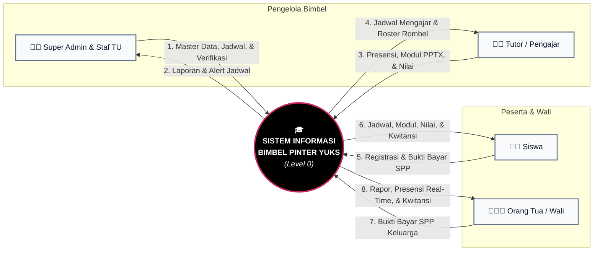

# Diagram Konteks (DFD Level 0) — Pinter Yuks Kota Palu

Diagram Konteks menggambarkan batasan sistem (*system boundary*) dan hubungan pertukaran informasi antara sistem informasi bimbingan belajar **Pinter Yuks** dengan entitas luar.

---

### 1. Visualisasi Diagram Konteks

---

### 2. Penjelasan Aliran Data Berdasarkan Penomoran

| No. | Aliran Data | Dari | Ke | Rincian Informasi Data |
| :---: | :--- | :---: | :---: | :--- |
| **1** | **Master Data, Jadwal, & Verifikasi** | Admin | Sistem | Data ruangan, tutor, paket belajar, alokasi jadwal anti-bentrok, verifikasi pendaftaran calon siswa, dan verifikasi bayar SPP. |
| **2** | **Laporan & Alert Jadwal** | Sistem | Admin | Notifikasi peringatan bentrok ruang/tutor, rekap kehadiran siswa, dan rekapitulasi keuangan. |
| **3** | **Presensi, Modul PPTX, & Nilai** | Tutor | Sistem | Checklist presensi sesi harian siswa (kunci 24 jam), unggah file modul & presentasi PPTX, serta input nilai tugas/try out. |
| **4** | **Jadwal Mengajar & Roster Rombel** | Sistem | Tutor | Kalender jadwal mengajar mingguan dan daftar siswa di tiap rombel kelas. |
| **5** | **Registrasi & Bukti Bayar SPP** | Siswa | Sistem | Form pendaftaran mandiri terproteksi Turnstile dan unggah foto struk transfer bank. |
| **6** | **Jadwal, Modul, Nilai, & Kwitansi** | Sistem | Siswa | Kalender bimbingan, modul & slide interaktif PPTX, riwayat kehadiran, rekap nilai, dan kwitansi lunas. |
| **7** | **Bukti Bayar SPP Keluarga** | Orang Tua | Sistem | Unggah bukti transfer pelunasan biaya bimbingan les anak. |
| **8** | **Rapor, Presensi Real-Time, & Kwitansi** | Sistem | Orang Tua | Status kehadiran anak hari ini (*Hadir/Sakit/Izin/Alpa*), grafik rapor nilai per mapel, catatan tutor, dan kwitansi digital lunas. |
