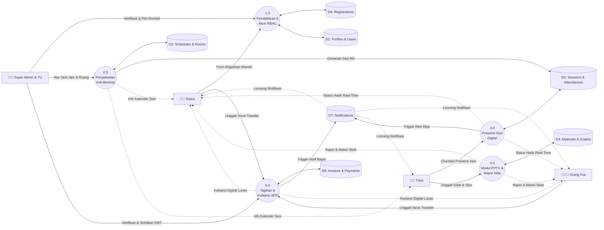
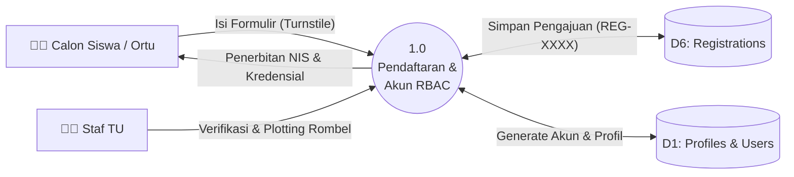
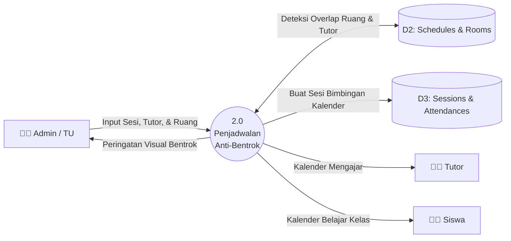
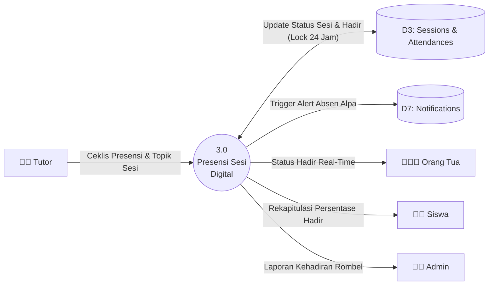
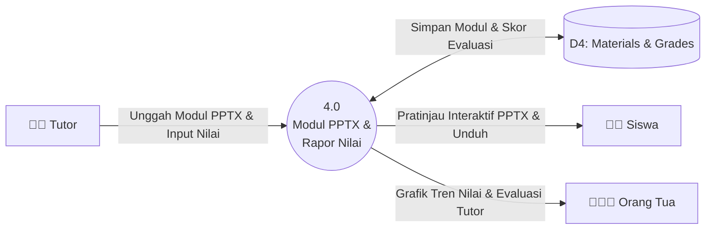
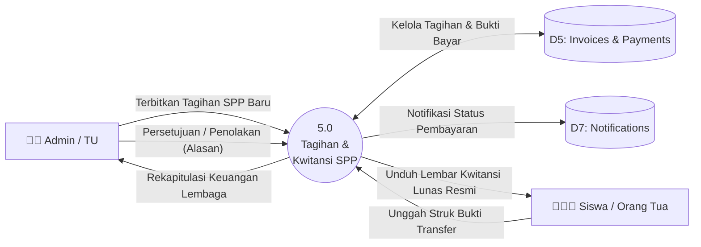

# Data Flow Diagram (DFD) Level 1 — Pinter Yuks Kota Palu

DFD Level 1 mendekomposisi sistem informasi bimbingan belajar **Pinter Yuks** menjadi **5 Proses Fungsional Utama** dan **7 Data Stores**.

---

### 1. Diagram Ikhtisar Alur Kerja Global (Global Pipeline)

Diagram ini memperlihatkan perjalanan data operasional dari hulu (pendaftaran) hingga hilir (pembayaran, presensi, & rapor):

---

### 2. Dekomposisi Terperinci per Proses Operasional

#### 2.1 Proses 1.0: Pendaftaran Mandiri, Verifikasi & Penetapan Rombel
Mengelola pendaftaran mandiri calon siswa (dilindungi Cloudflare Turnstile), verifikasi oleh staf TU, plotting rombel kelas (maksimal 12 siswa), dan penerbitan kredensial login resmi.

---

#### 2.2 Proses 2.0: Penjadwalan Bimbingan & Ruang Anti-Bentrok
Mengelola master ruang fisik dan alokasi jadwal bimbingan dengan validasi anti-bentrok tutor maupun ruangan, serta otomasi pembentukan sesi kalender aktual.

---

#### 2.3 Proses 3.0: Presensi Sesi Digital & Rekap Kehadiran
Tutor mencatat kehadiran siswa pada sesi pertemuan aktual (`hadir`, `sakit`, `izin`, `alpa`) dengan mekanisme kunci audit 24 jam.

---

#### 2.4 Proses 4.0: Modul PPTX Interaktif & Rapor Nilai
Tutor mengunggah modul belajar (PDF & slide presentasi PPTX) dan menginputkan skor evaluasi (Try Out, Kuis, Tugas) dengan kalkulasi nilai rata-rata rombel otomatis.

---

#### 2.5 Proses 5.0: Tagihan SPP, Bukti Bayar & Kwitansi Resmi
Mengatur penerbitan tagihan (`INV-XXXX`), penerimaan bukti transfer bank di Supabase Storage, persetujuan/penolakan transparan oleh admin, dan penerbitan kwitansi digital resmi berstempel (`KWT-XXXX`).

---

### 3. Pemetaan 7 Data Stores ke Skema Drizzle ORM

| Data Store | Tabel Relasional Terkait | Deskripsi Entitas Basis Data |
| :--- | :--- | :--- |
| **D1: Profiles & Users** | `profiles`, `students`, `parents`, `tutors` | Akun Supabase Auth, peran RBAC, status aktif, data profil, dan relasi multi-child perwalian. |
| **D2: Schedules & Rooms** | `rooms`, `courses`, `classes`, `class_members`, `schedules` | Ruang fisik, paket bimbingan, rombel kelas (kapasitas 12), anggota kelas, dan template jadwal mingguan. |
| **D3: Sessions & Attendances** | `sessions`, `attendances` | Pertemuan nyata per tanggal kalender, topik bimbingan, status selesai, kunci audit 24 jam, dan ceklis presensi semantik (`hadir`, `sakit`, `izin`, `alpa`). |
| **D4: Materials & Grades** | `materials`, `grades` | Modul berkas di Supabase Storage (`PDF`, `PPTX`), skor evaluasi belajar (0-100), rata-rata kelas, dan umpan balik kualitatif tutor. |
| **D5: Invoices & Payments** | `invoices`, `payments` | Tagihan SPP (`INV-XXXX`), bukti transfer di bucket `receipts`, verifikasi admin, alasan penolakan, dan nomor kwitansi (`KWT-XXXX`). |
| **D6: Registrations** | `registrations` | Pendaftaran mandiri siswa (`REG-XXXX`), biodata calon murid & orang tua, status pendaftaran (`menunggu`, `terverifikasi`, `ditolak`), dan penempatan rombel. |
| **D7: Notifications** | `notifications` | Notifikasi in-app lonceng waktu-nyata (tipe: `attendance`, `billing`, `academic`, `announcement`, `registration`) dan payload Web Push. |
