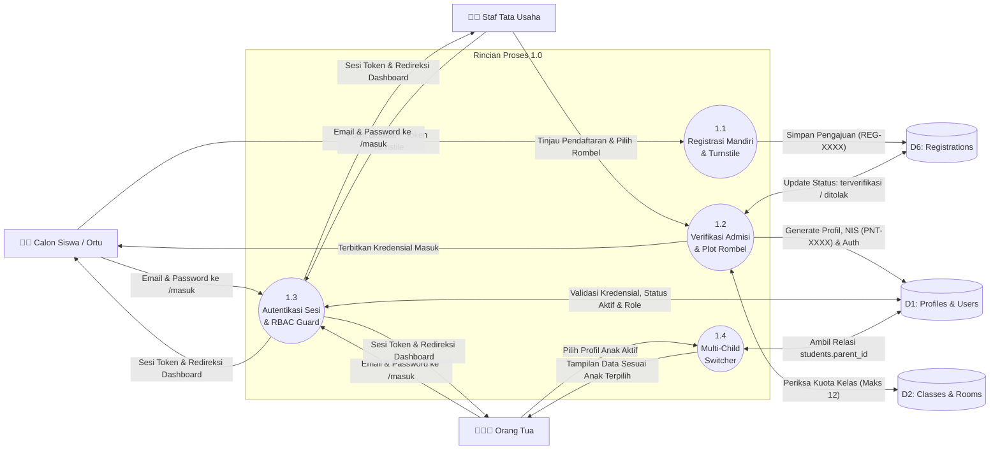
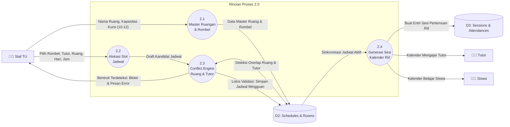
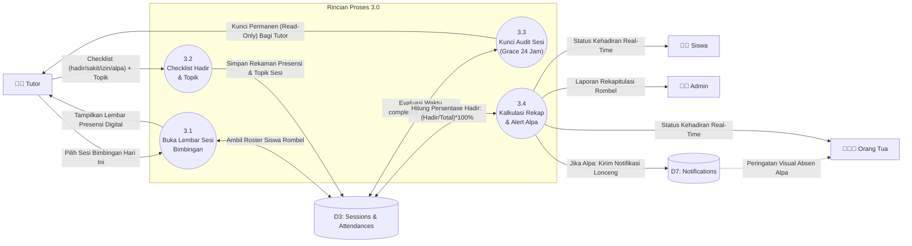
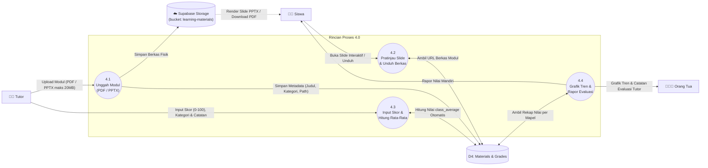
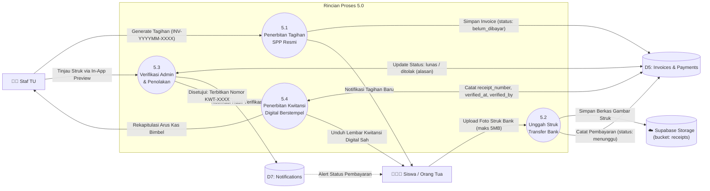

# Data Flow Diagram (DFD) Level 2 — Pinter Yuks Kota Palu

Dokumen ini membedah setiap proses operasional dari DFD Level 1 menjadi sub-proses detail (Level 2) yang tersinkronisasi 100% dengan arsitektur kode dan skema basis data **Pinter Yuks**.

---

## 1. DFD Level 2 — Proses 1.0 (Pendaftaran Mandiri, Verifikasi & Akun RBAC)

Dekomposisi dari proses **1.0 Pendaftaran & Akun RBAC** menangani registrasi mandiri calon siswa (dengan proteksi Turnstile), verifikasi dan plotting rombel oleh staf TU, penerbitan kredensial login, dan relasi multi-child perwalian.

### Kamus Data Sub-Proses 1.0:
* `1.1`: Input pendaftaran: `student_name`, `student_email`, `student_phone`, `student_school`, `package_code (SD/SMP/SMA/UTBK)`, `parent_name`, `parent_phone`, `turnstile_token`. Output: Nomor pendaftaran `REG-YYYYMM-XXXX` dengan status `menunggu`.
* `1.2`: Staf TU menyetujui pendaftaran dan menetapkan rombel kelas aktif (`assigned_class_id`). Sistem secara transaksional membuat akun auth, baris di `profiles`, `students`, `parents`, serta meng-generate NIS `PNT-YYYY-XXXX`. Jika ditolak, sistem mencatat `rejected_reason`.
* `1.3`: Validasi login via Supabase Auth di rute `/masuk`. Jika status akun `nonaktif`, sesi otomatis ditolak (*revoked*).
* `1.4`: Memfilter data presensi, nilai, dan tagihan SPP berdasarkan profil anak yang sedang dipilih pada *child-switcher* akun orang tua.

---

## 2. DFD Level 2 — Proses 2.0 (Penjadwalan Bimbingan & Ruang Anti-Bentrok)

Dekomposisi dari proses **2.0 Penjadwalan Anti-Bentrok** memperlihatkan validasi jadwal tanpa tumpang tindih dan pembentukan sesi bimbingan kalender aktual.

### Kamus Data Sub-Proses 2.0:
* `2.1`: Input master ruang: `room_name`, `capacity (10-12)`, `location`, `is_active`.
* `2.2`: Input draft jadwal: `class_id`, `tutor_id`, `room_id`, `day_of_week`, `start_time`, `end_time`.
* `2.3`: Algoritma deteksi bentrok:
  $$\text{Bentrok} \iff (\text{Target}_A = \text{Target}_B) \land (\text{Hari}_A = \text{Hari}_B) \land (\text{Mulai}_A < \text{Selesai}_B) \land (\text{Selesai}_A > \text{Mulai}_B)$$
* `2.4`: Dari jadwal berulang mingguan, sistem menghasilkan entri sesi bimbingan riil di tabel `sessions` dengan proteksi agar sesi lampau yang belum diabsen tidak bergeser (*overdue protection*).

---

## 3. DFD Level 2 — Proses 3.0 (Presensi Sesi Digital & Kunci Audit)

Dekomposisi dari proses **3.0 Presensi Sesi Digital** menunjukkan alur pencatatan kehadiran oleh pengajar hingga ke dashboard siswa dan orang tua dengan kunci audit 24 jam.

### Kamus Data Sub-Proses 3.0:
* `3.1`: Membaca entitas `sessions` aktif pada tanggal berjalan beserta daftar siswa yang terdaftar di kelas bersangkutan via relasi `class_members`.
* `3.2`: Input presensi: `session_id`, `student_id`, `status ('hadir'|'sakit'|'izin'|'alpa')`, `notes`, serta `topic` materi yang diajarkan.
* `3.3`: Menandai `is_completed = true` dan `completed_at = NOW()`. Selama 24 jam pertama, tutor berhak mengoreksi salah klik; setelah 24 jam, status terkunci permanen.
* `3.4`: Output rekap persentase kehadiran ke dashboard siswa dan orang tua. Jika ada status `alpa`, sistem otomatis menerbitkan notifikasi ke tabel `notifications`.

---

## 4. DFD Level 2 — Proses 4.0 (Modul Belajar PPTX Interaktif & Rapor Nilai)

Dekomposisi dari proses **4.0 Modul PPTX & Rapor Nilai** menguraikan penyimpanan materi ke Supabase Storage, penampil slide presentasi PPTX in-app, dan penghitungan rata-rata kelas otomatis.

### Kamus Data Sub-Proses 4.0:
* `4.1`: Berkas fisik diunggah ke bucket `learning-materials`. Metadata di tabel `materials`: `class_id`, `tutor_id`, `title`, `description`, `category ('Modul Teori'|'Latihan Soal'|'Bahan Bacaan')`, `file_type ('PDF'|'PPTX')`, `file_size`, `file_url`, `storage_path`.
* `4.2`: Siswa membuka slide presentasi interaktif PPTX langsung di peramban via `@extend-ai/react-pptx` atau mengunduh PDF.
* `4.3`: Input nilai di tabel `grades`: `student_id`, `class_id`, `tutor_id`, `subject_name`, `assessment_title`, `category ('Try Out'|'Kuis'|'Tugas')`, `score (0-100)`, `tutor_feedback`, `assessment_date`. Sistem mengagregasi dan menyimpan nilai `class_average`.
* `4.4`: Output grafik progres belajar komparatif antara nilai siswa dengan nilai rata-rata kelas bagi orang tua dan siswa.

---

## 5. DFD Level 2 — Proses 5.0 (Tagihan SPP, Bukti Bayar & Kwitansi Resmi)

Dekomposisi dari proses **5.0 Tagihan & Kwitansi SPP** memperlihatkan siklus penagihan, penyimpanan bukti transfer di Supabase Storage, verifikasi persetujuan/penolakan transparan, dan unduhan kwitansi digital.

### Kamus Data Sub-Proses 5.0:
* `5.1`: Staf TU menerbitkan tagihan: `student_id`, `invoice_number ('INV-YYYYMM-XXXX')`, `program_name`, `amount`, `due_date`, `status: belum_dibayar`.
* `5.2`: Siswa atau Orang Tua mengunggah berkas struk ke Supabase Storage bucket `receipts`. Sistem membuat entri di tabel `payments`: `invoice_id`, `amount`, `bank_name`, `payment_method`, `submitted_by_role`, `submitted_by_name`, `status: menunggu`. Status invoice bertransisi ke `menunggu_verifikasi`.
* `5.3`: Staf TU meninjau bukti transfer:
  * Jika bukti tidak valid: Status tagihan dan pembayaran berubah menjadi `ditolak` disertai `rejected_reason` agar pengunggah dapat memperbaikinya.
  * Jika bukti sah: Status tagihan dan pembayaran berubah menjadi `lunas`, mencatat `verified_by` dan `verified_at`.
* `5.4`: Sistem men-generate nomor kwitansi resmi unik `KWT-YYYYMM-XXXX`. Lembar kwitansi digital resmi berstempel Pinter Yuks dapat dicetak atau diunduh oleh siswa dan orang tua.
