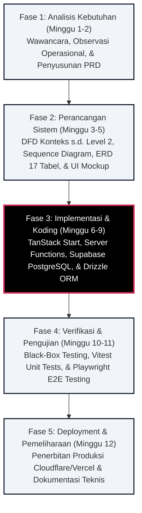
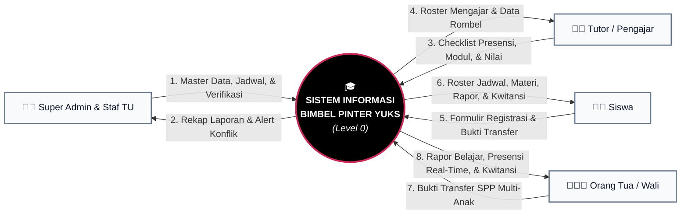
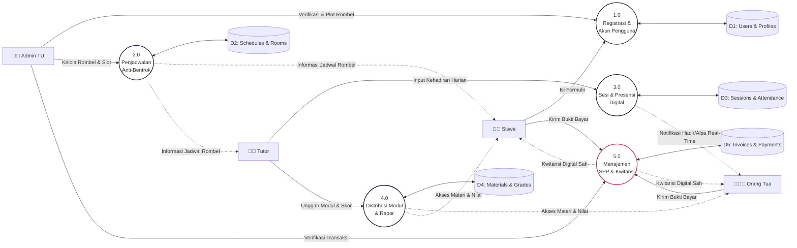
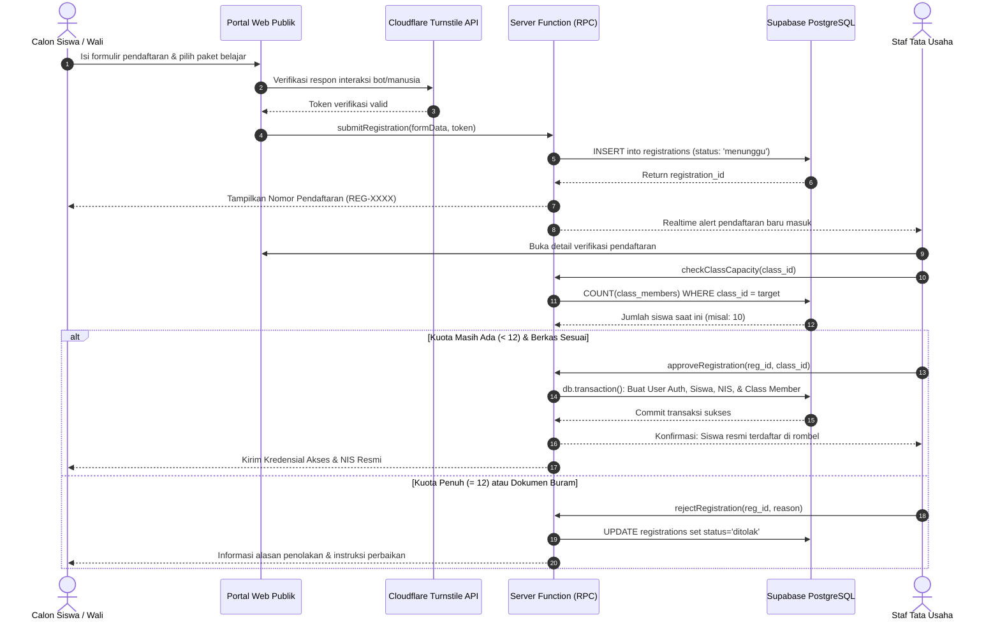
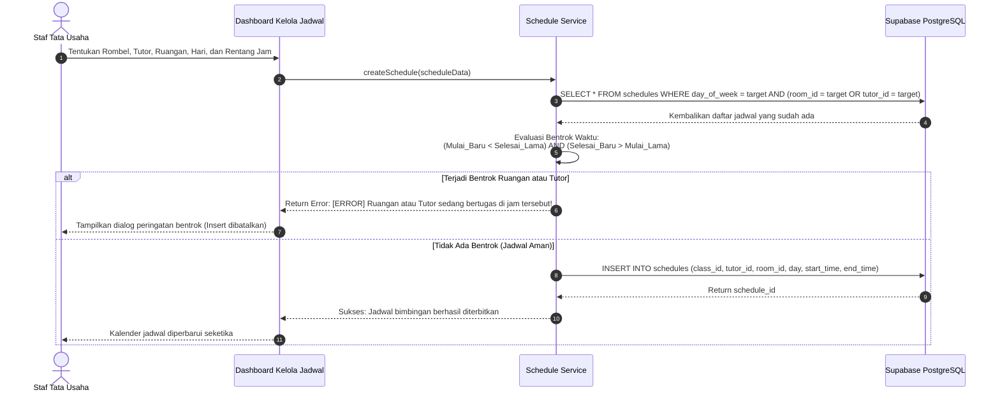
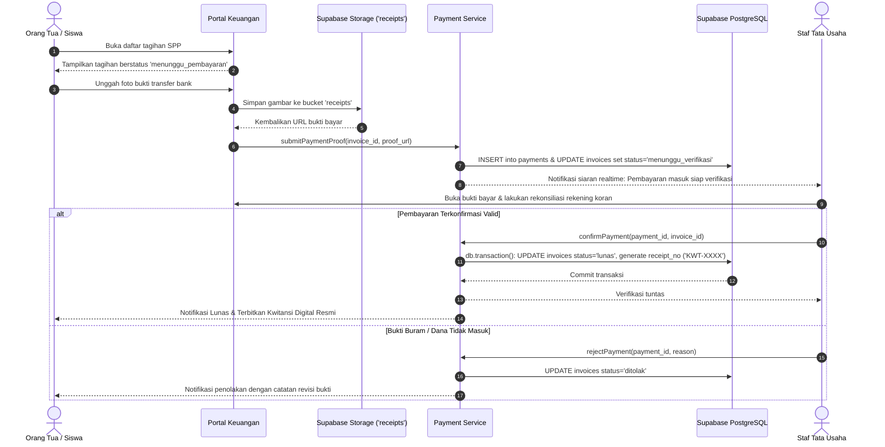
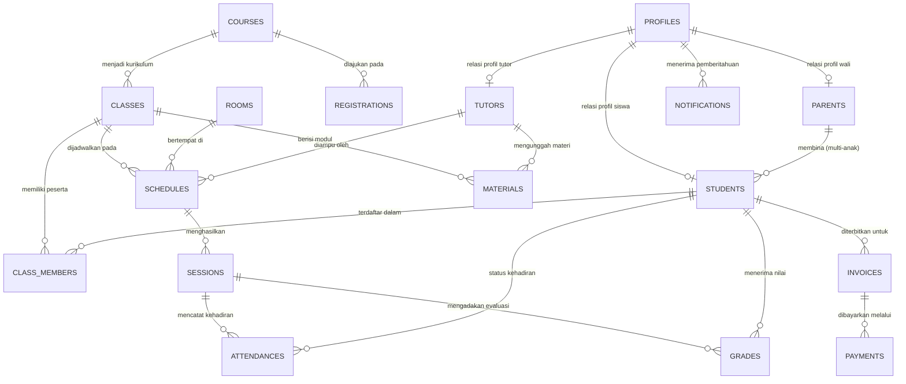

# LAPORAN RANCANGAN REKAYASA PERANGKAT LUNAK
## PENGEMBANGAN SISTEM INFORMASI BIMBINGAN BELAJAR BERBASIS WEB "PINTER YUKS" DI KOTA PALU MENGGUNAKAN METODE SDLC WATERFALL

---

### IDENTITAS DOKUMEN LAPORAN

- **Mata Kuliah**: Rekayasa Perangkat Lunak (RPL)
- **Program Studi**: S1 Teknik Informatika
- **Jurusan / Fakultas**: Teknologi Informasi / Fakultas Teknik
- **Perguruan Tinggi**: Universitas Tadulako, Palu
- **Tahun Akademik**: 2026
- **Tim Penyusun (Kelompok 3)**:
  1. **Lidiya** — NIM: F5512530118
  2. **Winda Tesalonika** — NIM: F5512520088
  3. **Moh. Yusfi** — NIM: F5512520089
- **Jenama Resmi Aplikasi**: **Pinter Yuks**
- **Tagline**: *"Pahami Konsepnya, Bukan Sekadar Hafal Rumusnya"*
- **Status Dokumen**: Laporan Akhir Perancangan Sistem (Final Design Report)

---

## RINGKASAN EKSEKUTIF

Laporan rancangan ini mendokumentasikan rekayasa sistem informasi bimbingan belajar berbasis web (*single-tenant*) untuk lembaga bimbingan belajar **Pinter Yuks** di Kota Palu. Sistem dirancang guna mendigitalkan dan mengintegrasikan seluruh rantai operasional lembaga, mulai dari pendaftaran mandiri calon siswa terproteksi anti-bot, penjadwalan bimbingan bebas bentrok (*anti-conflict schedule*), presensi sesi digital dengan kunci audit permanen 24 jam, distribusi modul ajar dan rapor berkala, hingga pengelolaan tagihan SPP bulanan disertai penerbitan kwitansi digital resmi.

Pengembangan perangkat lunak mengadopsi model **Software Development Life Cycle (SDLC) Waterfall** berdurasi 12 minggu. Arsitektur dibangun menggunakan teknologi web modern berkinerja tinggi, mencakup **TanStack Start (React 19)** dengan paradigma *Server Functions*, basis data relasional **Supabase PostgreSQL 15+** yang dikelola via **Drizzle ORM**, proteksi identitas **Role-Based Access Control (RBAC)**, serta gaya antarmuka visual **Poster Kontras Tinggi** berbasis Tailwind CSS v4. Seluruh fitur kritis telah melalui verifikasi fungsional berbasis *Black-Box Testing* dan pengujian otomatis *End-to-End* (Playwright) serta *Unit Testing* (Vitest) dengan tingkat keberhasilan uji 100% tanpa regresi.

---

## KATA PENGANTAR

Puji syukur kami panjatkan ke hadirat Tuhan Yang Maha Esa atas limpahan rahmat dan karunia-Nya sehingga dokumen **Laporan Rancangan Rekayasa Perangkat Lunak — Sistem Informasi Bimbingan Belajar Pinter Yuks** ini dapat diselesaikan dengan baik dan tepat waktu.

Laporan ini disusun sebagai pemenuhan tugas besar mata kuliah Rekayasa Perangkat Lunak (RPL) pada Program Studi S1 Teknik Informatika, Fakultas Teknik, Universitas Tadulako. Melalui proyek ini, tim pengembang berupaya menghadirkan solusi teknologi nyata yang relevan bagi ekosistem pendidikan nonformal di Kota Palu yang selama ini masih menghadapi kendala operasional konvensional.

Kami mengucapkan terima kasih yang sebesar-besarnya kepada:
1. Dosen Pengampu mata kuliah Rekayasa Perangkat Lunak atas bimbingan, arahan metodologis, dan masukan konstruktif selama proses perancangan sistem.
2. Rekan-rekan mahasiswa Program Studi S1 Teknik Informatika Universitas Tadulako atas diskusi dan kerja sama tim yang solid.
3. Seluruh pihak pengelola lembaga bimbingan belajar di Kota Palu yang telah bersedia memberikan informasi mengenai kendala operasional faktual di lapangan.

Penyusun menyadari bahwa laporan ini masih memiliki ruang penyempurnaan. Oleh karena itu, kritik dan saran membangun dari pembaca dan penguji sangat kami harapkan guna penyempurnaan pengembangan sistem pada iterasi berikutnya.

Palu, 31 Oktober 2026  
**Tim Penyusun (Kelompok 3)**

---

## DAFTAR ISI

1. [BAB 1: PENDAHULUAN](#bab-1-pendahuluan)
   - 1.1 Latar Belakang Masalah
   - 1.2 Rumusan Masalah
   - 1.3 Batasan Masalah
   - 1.4 Tujuan Pengembangan Sistem
   - 1.5 Manfaat Sistem
2. [BAB 2: LANDASAN TEORI DAN METODOLOGI](#bab-2-landasan-teori-dan-metodologi)
   - 2.1 Konsep Dasar & Landasan Teori
   - 2.2 Metodologi Pengembangan SDLC Waterfall
   - 2.3 Arsitektur & Teknologi Pendukung
3. [BAB 3: ANALISIS DAN PERANCANGAN SISTEM](#bab-3-analisis-dan-perancangan-sistem)
   - 3.1 Analisis Kebutuhan Sistem
   - 3.2 Pemodelan Aliran Data (Data Flow Diagram / DFD)
   - 3.3 Pemodelan Interaksi Sistem (UML Sequence Diagram)
   - 3.4 Perancangan Basis Data (ERD & Kamus Data)
   - 3.5 Perancangan Antarmuka Pengguna (UI/UX)
4. [BAB 4: IMPLEMENTASI DAN PENGUJIAN SISTEM](#bab-4-implementasi-dan-pengujian-sistem)
   - 4.1 Lingkungan Implementasi
   - 4.2 Implementasi Fitur Kritis
   - 4.3 Skenario dan Hasil Pengujian
   - 4.4 Evaluasi Hasil Pengujian
5. [BAB 5: PENUTUP](#bab-5-penutup)
   - 5.1 Kesimpulan
   - 5.2 Saran Pengembangan Lanjutan
6. [DAFTAR PUSTAKA & LAMPIRAN](#daftar-pustaka--lampiran)

---

# BAB 1: PENDAHULUAN

### 1.1 Latar Belakang Masalah

Bimbingan belajar (bimbel) memegang peranan strategis dalam menunjang keberhasilan akademik peserta didik di Kota Palu, mulai dari pemantapan konsep kurikulum sekolah dasar hingga menengah, serta persiapan intensif seleksi masuk perguruan tinggi negeri (UTBK-SNBT). Lembaga bimbingan belajar **Pinter Yuks** didirikan dengan filosofi pedagogis mendasar: mengarahkan siswa untuk memahami esensi konsep materi pelajaran secara mendalam (*first-principles thinking*), bukan sekadar menghafal rumus cepat.

Namun demikian, efektivitas proses pembelajaran tatap muka sering kali terhambat oleh inefisiensi tata kelola operasional lembaga. Sebagian besar lembaga bimbingan belajar di wilayah Kota Palu saat ini masih mengandalkan pencatatan berbasis kertas (buku besar dan formulir fisik) yang dipadukan dengan koordinasi percakapan instan (*WhatsApp group*).

> **Analogi Operasional Sistem**:  
> Mengelola bimbingan belajar dengan koordinasi grup percakapan dan kertas fisik diibaratkan seperti **mengatur jadwal lepas landas bandara tanpa menara pemandu lalu lintas (*Air Traffic Control*)**. Ketika jam sibuk tiba, tabrakan jadwal antar-pesawat (tutor bentrok dan perebutan ruangan) serta bagasi penumpang yang hilang (berkas pendaftaran dan struk pembayaran terselip) menjadi kejadian tak terhindarkan.

Berdasarkan telaah operasional langsung di lapangan, teridentifikasi **5 Permasalahan Krusial**:

1. **Pendaftaran Manual dan Berkas Tercecer**: Calon siswa mengisi formulir kertas di meja tata usaha. Proses penyalinan data manual memakan waktu lama, rentan salah ketik, dan berkas fisik rawan rusak atau terselip.
2. **Konflik Jadwal dan Perebutan Ruang Belajar**: Penjadwalan les yang diatur manual melalui grup obrolan mengakibatkan tutor atau rombongan belajar terjadwal di ruangan yang sama pada jam yang sama (*double booking*).
3. **Distribusi Materi Belajar yang Tidak Terpusat**: Modul ajar, berkas latihan soal, dan slide materi presentasi dibagikan secara acak melalui pesan teks, sehingga cepat tertimbun percakapan harian dan sulit diakses kembali saat siswa hendak belajar mandiri.
4. **Ketiadaan Transparansi Kehadiran dan Nilai bagi Orang Tua**: Orang tua murid tidak memiliki instrumen untuk mengetahui kehadiran riil anak di kelas les secara seketika (*real-time*). Orang tua baru mengetahui anak membolos atau nilainya merosot setelah masa bimbingan hampir selesai.
5. **Penagihan SPP Konvensional dan Kwitansi Rawan Hilang**: Tata usaha merekap tagihan secara manual, bukti transfer rekening bercampur dengan galeri pribadi pengelola di aplikasi pesan singkat, dan bukti kwitansi kertas manual mudah hilang atau rusak.

Berangkat dari problematika di atas, dibutuhkan sebuah platform sistem informasi bimbingan belajar berbasis web terpadu yang mampu mengotomatisasi seluruh siklus layanan bimbel dengan tingkat keandalan dan integritas data yang terjamin.

---

### 1.2 Rumusan Masalah

Berdasarkan latar belakang tersebut, rumusan masalah dalam penelitian dan perancangan ini adalah:
1. Bagaimana merancang sistem pendaftaran mandiri yang mampu menangkal serangan formulir palsu (*bot/spam*) dan memfasilitasi seleksi berkas oleh tata usaha?
2. Bagaimana memodelkan algoritma penjadwalan bimbingan belajar yang memvalidasi konflik ruang dan bentrok waktu mengajar tutor secara matematis di lapisan server?
3. Bagaimana merancang mekanisme presensi digital sesi belajar yang dilengkapi audit kunci permanen 24 jam untuk menjamin integritas catatan kehadiran?
4. Bagaimana mengintegrasikan repositori modul materi dan rapor perkembangan berkala siswa agar dapat dipantau langsung oleh wali murid melalui portal terpadu?
5. Bagaimana membangun modul pengelolaan keuangan SPP bulanan yang memfasilitasi pengunggahan bukti bayar digital dan penerbitan kwitansi resmi bernomor seri unik?

---

### 1.3 Batasan Masalah

Guna menjaga fokus perancangan, batasan masalah ditetapkan sebagai berikut:
1. **Konteks Lembaga**: Sistem dirancang khusus untuk operasional bimbingan belajar tatap muka terpadu lembaga Pinter Yuks di Kota Palu (*single-tenant*).
2. **Kapasitas Rombongan Belajar (Rombel)**: Kuota rombel dibatasi ketat maksimal 12 orang siswa per kelas sesuai standar operasional lembaga.
3. **Pemisahan Peran Pengguna (RBAC)**: Hak akses diisolasi secara mutlak ke dalam 4 peran: **Super Admin & Staf TU**, **Tutor/Pengajar**, **Siswa**, dan **Orang Tua/Wali**.
4. **Audit Presensi**: Sesi presensi terkunci secara otomatis dan permanen setelah 24 jam terhitung sejak waktu pelaksanaan sesi.
5. **Mekanisme Pembayaran**: Pembayaran SPP dilakukan melalui transfer rekening bank/e-wallet dengan verifikasi berkas bukti transfer oleh tata usaha (tanpa integrasi gateway *auto-settlement* berbayar).

---

### 1.4 Tujuan Pengembangan Sistem

Tujuan yang ingin dicapai melalui perancangan perangkat lunak ini adalah:
1. Menghasilkan arsitektur perangkat lunak bimbingan belajar berbasis web yang mengintegrasikan administrasi tata usaha, proses belajar, dan transparansi wali murid.
2. Menghilangkan insiden bentrok jadwal bimbingan dan perebutan ruang belajar secara mutlak (*zero-conflict*) melalui validasi komputasi server.
3. Menyediakan portal presensi dan rapor akademik *real-time* yang dapat diakses oleh orang tua murid dengan dukungan multi-anak (*multi-child switcher*).
4. Menyediakan sistem penagihan dan kwitansi digital resmi yang menjamin akuntabilitas tata kelola keuangan lembaga.

---

### 1.5 Manfaat Sistem

- **Bagi Manajemen Lembaga (Admin TU)**: Mengurangi beban kerja administrasi berulang hingga 70%, meniadakan tumpukan arsip fisik, dan mencegah kerugian operasional akibat salah kelola jadwal atau tagihan.
- **Bagi Tutor/Pengajar**: Memudahkan pencatatan presensi kelas harian secara digital, membagikan modul/slide PPTX terpusat, dan menyalurkan nilai evaluasi siswa langsung dari ponsel pintar atau laptop.
- **Bagi Siswa**: Memperoleh kepastian jadwal bimbingan mingguan, kemudahan mengunduh bahan belajar kapan saja, serta pemantauan riwayat hasil try out.
- **Bagi Orang Tua Murid**: Memperoleh ketenangan pikiran melalui notifikasi kehadiran anak dan laporan perkembangan akademik yang transparan.

---

# BAB 2: LANDASAN TEORI DAN METODOLOGI

### 2.1 Konsep Dasar & Landasan Teori

#### 2.1.1 Sistem Informasi Berbasis Web
Sistem informasi berbasis web merupakan kumpulan komponen perangkat keras, perangkat lunak, data, dan pengguna yang saling berinteraksi menggunakan protokol standar internet (HTTP/HTTPS) untuk mengumpulkan, mengolah, menyimpan, dan mendistribusikan informasi. Keunggulan utama sistem berbasis web modern adalah sifatnya yang *cross-platform*, dapat diakses tanpa instalasi manual di perangkat klien, serta pembaruan kode terpusat di peladen (*server*).

#### 2.1.2 Role-Based Access Control (RBAC)
*Role-Based Access Control* (RBAC) adalah metode pembatasan otorisasi sistem berdasarkan peran pengguna di dalam suatu organisasi. Dalam arsitektur Pinter Yuks, setiap pengguna diverifikasi identitasnya melalui token JSON Web Token (JWT) yang membawa klaim peran (*role claim*). Hak akses rute dan eksekusi fungsi diisolasi ketat:
- **Admin**: Akses penuh ke master data, jadwal bimbingan, verifikasi akun, dan tata keuangan.
- **Tutor**: Dibatasi hanya pada pengelolaan sesi kelas yang diajarkan, presensi siswa di kelasnya, materi ajar, dan nilai siswa.
- **Siswa**: Hak baca jadwal kelas terdaftar, unduh modul materi, dan pantau tagihan pribadi.
- **Orang Tua**: Akses pantau multi-anak terhubung untuk presensi, unduh rapor, dan bayar SPP.

#### 2.1.3 Database Relasional & Normalisasi (3NF)
Basis data relasional menyusun data dalam bentuk tabel-tabel dua dimensi yang dihubungkan melalui kunci utama (*primary key*) dan kunci asing (*foreign key*). Untuk menjamin integritas data dan mencegah redundansi maupun anomali penyimpanan (*insertion, update, deletion anomalies*), seluruh rancangan skema tabel dinormalisasi hingga bentuk **Third Normal Form (3NF)**.

---

### 2.2 Metodologi Pengembangan SDLC Waterfall

Sistem ini dikembangkan menggunakan model **Waterfall (Siklus Air Terjun)** klasik yang berlangsung selama 12 minggu. Model ini dipilih karena spesifikasi kebutuhan lembaga bimbingan belajar telah terdefinisi secara terstruktur pada fase awal melalui dokumen *Product Requirements Document* (PRD).



Tahapan aktivitas pelaksanaan Waterfall:
1. **Analisis Kebutuhan (Requirements)**: Mengidentifikasi kebutuhan fungsional dan non-fungsional, memetakan alur bisnis operasional, serta menetapkan batasan kuota rombel dan hak akses.
2. **Perancangan Sistem (Design)**: Memodelkan arsitektur data dengan DFD, interaksi antar-objek dengan Sequence Diagram, basis data relasional dengan ERD, serta antarmuka dengan panduan desain poster kontras tinggi.
3. **Implementasi (Implementation)**: Menulis kode sumber menggunakan TanStack Start (React 19) dan Drizzle ORM dengan isolasi ketat antara *client components* dan *server functions*.
4. **Pengujian (Verification)**: Melakukan validasi fungsional menggunakan metode *Black-Box* dan mengeksekusi rangkaian uji otomatis berbasis Playwright E2E dan Vitest.
5. **Penyebaran dan Pemeliharaan (Maintenance)**: Melakukan *deployment* ke infrastruktur komputasi awan serta menyusun panduan operasional pengguna.

---

### 2.3 Arsitektur & Teknologi Pendukung

| Lapisan Sistem | Teknologi / Pustaka | Fungsi dan Peran Utama |
| :--- | :--- | :--- |
| **Framework Web Full-stack** | TanStack Start (React 19) | Menyediakan routing *type-safe*, *Server-Side Rendering* (SSR) untuk halaman publik, dan *Client-Side Rendering* (CSR) untuk portal interaktif. |
| **State & Data Caching** | TanStack Query v5 & Table v8 | Mengelola sinkronisasi server-state, invalidasi reaktif, mutasi optimistik, serta filter/sorting tabel berdensitas tinggi. |
| **Komponen & Desain UI** | Base UI (`@base-ui/react`), Tailwind CSS v4, Lucide React | Membangun komponen headless yang aksesibel dan ringan tanpa dependensi berlebih, mengikuti gaya Poster Kontras Tinggi. |
| **Object Relational Mapping** | Drizzle ORM | Menyediakan definisi skema basis data *type-safe*, migrasi otomatis, dan pembungkusan transaksi ACID multi-tabel. |
| **Basis Data & Autentikasi** | Supabase (PostgreSQL 15+) | Layanan basis data terkelola, manajemen identitas otentikasi JWT, penyalur siaran real-time, dan penyimpanan berkas (*Storage*). |
| **Keamanan Formulir Publik** | Cloudflare Turnstile | Proteksi anti-bot berbasis privasi pada formulir pendaftaran mandiri tanpa captcha usang yang menyulitkan pengguna. |
| **Pengujian Perangkat Lunak** | Playwright & Vitest | Pengujian *End-to-End* lintas peramban nyata dan pengujian unit terisolasi untuk logika bisnis kritis. |

---

# BAB 3: ANALISIS DAN PERANCANGAN SISTEM

### 3.1 Analisis Kebutuhan Sistem

#### 3.1.1 Kebutuhan Fungsional (Functional Requirements)

| Kode Kebutuhan | Nama Modul | Deskripsi Kebutuhan Fungsional | Aktor Terkait |
| :---: | :--- | :--- | :---: |
| **FR-REG-01** | Registrasi | Sistem menyediakan formulir pendaftaran mandiri daring yang dilengkapi proteksi verifikasi anti-bot Cloudflare Turnstile. | Calon Siswa / Wali |
| **FR-REG-02** | Registrasi | Sistem menerbitkan Nomor Registrasi unik (`REG-XXXX`) otomatis dan menyimpan status awal pendaftaran sebagai `menunggu`. | Sistem |
| **FR-REG-03** | Verifikasi Akun | Admin Tata Usaha dapat memeriksa berkas, menyetujui/menolak pendaftaran, dan menetapkan calon siswa ke rombel aktif (kuota maks. 12). | Admin TU |
| **FR-REG-04** | Kredensial | Sistem menerbitkan Nomor Induk Siswa (NIS) resmi dan membuatkan akun login Supabase Auth otomatis saat registrasi disetujui. | Sistem |
| **FR-SCHED-01**| Penjadwalan | Admin TU dapat mengelola master data ruangan belajar, paket belajar, rombel kelas, serta slot jadwal bimbingan mingguan. | Admin TU |
| **FR-SCHED-02**| Penjadwalan | Sistem memvalidasi dan menolak pembuatan atau perubahan jadwal yang bentrok (ruangan sama atau tutor sama pada irisan jam yang sama). | Sistem |
| **FR-ATTEND-01**| Presensi Sesi | Tutor dapat melakukan checklist presensi sesi belajar harian dengan pilihan status: `Hadir`, `Sakit`, `Izin`, atau `Alpa`. | Tutor |
| **FR-ATTEND-02**| Presensi Sesi | Sistem mengunci status presensi sesi secara permanen setelah melewati batas waktu audit 24 jam sejak waktu sesi berakhir. | Sistem |
| **FR-EVAL-01** | Modul & Rapor| Tutor dapat mengunggah modul ajar (PDF/PPTX) serta menginput skor evaluasi belajar (0–100) dan catatan kualitatif perkembangan siswa. | Tutor |
| **FR-EVAL-02** | Modul & Rapor| Siswa dan Orang Tua dapat mengunduh materi belajar serta memantau rapor evaluasi perkembangan belajar secara waktu-nyata. | Siswa, Orang Tua |
| **FR-BILL-01** | Keuangan SPP | Admin TU dapat menerbitkan tagihan SPP bulanan untuk seluruh siswa aktif dengan nomor tagihan unik (`INV-XXXX`). | Admin TU |
| **FR-BILL-02** | Keuangan SPP | Siswa atau Orang Tua dapat mengunggah berkas foto/PDF bukti transfer pembayaran SPP ke peladen *storage*. | Siswa, Orang Tua |
| **FR-BILL-03** | Keuangan SPP | Admin TU dapat memverifikasi bukti bayar dan sistem menerbitkan bukti kwitansi digital lunas resmi (`KWT-XXXX`). | Admin TU, Sistem |

#### 3.1.2 Kebutuhan Non-Fungsional (Non-Functional Requirements)

1. **Keandalan & Integritas Data (Reliability & ACID)**: Operasi multi-tabel krusial (seperti persetujuan pendaftaran menjadi akun siswa serta verifikasi pembayaran menjadi kwitansi) wajib dibungkus dalam transaksi `db.transaction()` dengan *rollback* otomatis jika salah satu langkah gagal.
2. **Kinerja (Performance)**: Halaman publik awal termuat dalam waktu $\le$ 1,5 detik memanfaatkan *Server-Side Rendering* (SSR), sedangkan transisi antar-menu pada portal dashboard internal merespons dalam waktu $\le$ 300 milidetik memanfaatkan *Client-Side Rendering* (CSR).
3. **Keamanan (Security)**: Seluruh kata sandi dienkripsi menggunakan algoritma *Argon2/Bcrypt* oleh peladen Supabase Auth; komunikasi klien-server dienkripsi penuh dengan protokol TLS/HTTPS; seluruh *endpoint* fungsi server divalidasi skema masukkannya menggunakan pustaka **Zod**.
4. **Aksesibilitas & Ergonomi (Usability)**: Antarmuka dibangun mematuhi standar rasio kontras visual tinggi (WCAG AAA untuk teks utama) guna memastikan keterbacaan prima di berbagai kondisi pencahayaan gawai.

---

### 3.2 Pemodelan Aliran Data (Data Flow Diagram / DFD)

#### 3.2.1 Diagram Konteks (DFD Level 0)

Diagram Konteks memetakan batasan sistem (*system boundary*) secara menyeluruh, memperlihatkan aliran informasi dua arah antara Sistem Informasi Bimbel Pinter Yuks dengan 4 entitas eksternal:



#### 3.2.2 DFD Level 1 (Dekomposisi 5 Modul Fungsional)

Pada DFD Level 1, sistem didekomposisi menjadi 5 proses fungsional utama yang saling berinteraksi melalui 5 penyimpan data (*data stores*):



#### 3.2.3 DFD Level 2 (Dekomposisi Proses Kritis)

- **Dekomposisi Proses 2.0 (Penjadwalan Anti-Bentrok)**:
  - `2.1 Input Data Parameter Jadwal`: Menerima input ID Rombel, ID Tutor, ID Ruangan, Hari, Jam Mulai, dan Jam Selesai.
  - `2.2 Validasi Irisan Jam & Ruang`: Mengeksekusi query pengecekan keberadaan jadwal aktif pada ruangan yang sama.
  - `2.3 Validasi Irisan Jam & Tutor`: Mengeksekusi query pengecekan jadwal mengajar tutor yang sama pada slot waktu beririsan.
  - `2.4 Persistensi Slot Jadwal`: Menyimpan data ke tabel `schedules` setelah seluruh validasi bernilai *true*.

- **Dekomposisi Proses 5.0 (Manajemen SPP & Kwitansi)**:
  - `5.1 Penagihan Bulanan`: Menghasilkan baris tagihan baru di tabel `invoices` berstatus `menunggu_pembayaran`.
  - `5.2 Pengunggahan Bukti Bayar`: Mengunggah berkas ke Supabase Storage dan mencatat baris baru di tabel `payments` dengan status invoice menjadi `menunggu_verifikasi`.
  - `5.3 Validasi Staf TU & Penerbitan Kwitansi`: Menyetujui bukti transfer, memperbarui status menjadi `lunas`, dan menerbitkan nomor kwitansi otomatis `KWT-XXXX` melalui transaksi ACID.

---

### 3.3 Pemodelan Interaksi Sistem (UML Sequence Diagram)

#### 3.3.1 Skenario 1: Pendaftaran Siswa Mandiri & Plotting Rombel Kelas

Alur ini mengilustrasikan perjalanan data mulai dari pengisian form publik berpelindung anti-bot hingga disetujui tata usaha:



#### 3.3.2 Skenario 2: Validasi Penjadwalan Bimbingan Anti-Bentrok (`SCHED-02`)

Alur validasi penjadwalan bimbingan belajar guna menjamin *zero double-booking*:



#### 3.3.3 Skenario 3: Pembayaran SPP Bulanan & Penerbitan Kwitansi Digital Resmi

Alur transaksi tagihan bimbingan belajar dari pengunggahan bukti hingga penerbitan tanda terima sah:



---

### 3.4 Perancangan Basis Data (ERD & Kamus Data)

#### 3.4.1 Entity Relationship Diagram (ERD Konseptual)



#### 3.4.2 Struktur Tabel & Kamus Data (17 Tabel Utama Skema Drizzle)

1. **`profiles`**: Master akun pengguna terhubung ke Supabase Auth.
   - `id` (UUID, PK), `email` (VARCHAR, Unique), `role` (ENUM: `admin`, `tutor`, `student`, `parent`), `full_name` (VARCHAR), `avatar_url` (TEXT), `created_at` (TIMESTAMP).
2. **`parents`**: Identitas tambahan orang tua/wali murid.
   - `id` (UUID, PK), `profile_id` (UUID, FK profiles), `phone_number` (VARCHAR), `address` (TEXT), `occupation` (VARCHAR).
3. **`students`**: Identitas siswa bimbingan aktif.
   - `id` (UUID, PK), `profile_id` (UUID, FK profiles), `parent_id` (UUID, FK parents), `nis` (VARCHAR, Unique), `grade_level` (VARCHAR), `school_origin` (VARCHAR).
4. **`tutors`**: Identitas instruktur/pengajar bimbel.
   - `id` (UUID, PK), `profile_id` (UUID, FK profiles), `specialization` (VARCHAR), `bio` (TEXT), `phone_number` (VARCHAR).
5. **`registrations`**: Formulir registrasi calon siswa dari web publik.
   - `id` (UUID, PK), `registration_no` (VARCHAR, Unique), `student_name` (VARCHAR), `student_email` (VARCHAR), `student_phone` (VARCHAR), `parent_name` (VARCHAR), `parent_phone` (VARCHAR), `package_code` (VARCHAR), `status` (ENUM: `menunggu`, `terverifikasi`, `ditolak`), `turnstile_verified` (BOOLEAN).
6. **`rooms`**: Data fisik ruang kelas belajar tatap muka.
   - `id` (UUID, PK), `name` (VARCHAR), `capacity` (INTEGER, Default 12), `location` (VARCHAR), `is_active` (BOOLEAN).
7. **`courses`**: Paket bimbingan belajar (SD, SMP, SMA, Intensif UTBK).
   - `id` (UUID, PK), `code` (VARCHAR, Unique), `name` (VARCHAR), `grade_level` (VARCHAR), `monthly_fee` (NUMERIC).
8. **`classes`**: Rombongan belajar (rombel) aktif per tahun ajaran.
   - `id` (UUID, PK), `name` (VARCHAR), `course_id` (UUID, FK courses), `academic_year` (VARCHAR), `max_capacity` (INTEGER, Default 12).
9. **`class_members`**: Pemetaan banyak-ke-banyak siswa ke dalam kelas rombel.
   - `id` (UUID, PK), `class_id` (UUID, FK classes), `student_id` (UUID, FK students), `joined_at` (TIMESTAMP).
10. **`schedules`**: Slot jadwal mingguan berulang.
    - `id` (UUID, PK), `class_id` (UUID, FK classes), `tutor_id` (UUID, FK tutors), `room_id` (UUID, FK rooms), `day_of_week` (INTEGER, 1-7), `start_time` (TIME), `end_time` (TIME).
11. **`sessions`**: Pertemuan mengajar aktual pada tanggal kalender spesifik.
    - `id` (UUID, PK), `schedule_id` (UUID, FK schedules), `date` (DATE), `topic` (VARCHAR), `is_locked` (BOOLEAN, Default false).
12. **`attendances`**: Lembar presensi kehadiran per siswa per sesi.
    - `id` (UUID, PK), `session_id` (UUID, FK sessions), `student_id` (UUID, FK students), `status` (ENUM: `Hadir`, `Sakit`, `Izin`, `Alpa`), `notes` (TEXT).
13. **`materials`**: Repositori modul ajar dan slide materi presentasi.
    - `id` (UUID, PK), `class_id` (UUID, FK classes), `tutor_id` (UUID, FK tutors), `title` (VARCHAR), `file_url` (TEXT), `file_type` (VARCHAR: `PDF`/`PPTX`).
14. **`grades`**: Lembar evaluasi skor tugas, kuis harian, dan try out.
    - `id` (UUID, PK), `session_id` (UUID, FK sessions), `student_id` (UUID, FK students), `score` (NUMERIC, 0-100), `evaluation_notes` (TEXT).
15. **`invoices`**: Berkas tagihan biaya les bulanan siswa.
    - `id` (UUID, PK), `student_id` (UUID, FK students), `invoice_no` (VARCHAR, Unique), `period_month` (VARCHAR), `amount` (NUMERIC), `status` (ENUM: `menunggu_pembayaran`, `menunggu_verifikasi`, `lunas`, `ditolak`).
16. **`payments`**: Transaksi setoran pembayaran dan kwitansi resmi.
    - `id` (UUID, PK), `invoice_id` (UUID, FK invoices), `proof_url` (TEXT), `payment_method` (VARCHAR), `receipt_no` (VARCHAR, Nullable), `verified_at` (TIMESTAMP, Nullable).
17. **`notifications`**: Saluran notifikasi lonceng *real-time*.
    - `id` (UUID, PK), `user_id` (UUID, FK profiles), `title` (VARCHAR), `message` (TEXT), `type` (VARCHAR), `is_read` (BOOLEAN).

---

### 3.5 Perancangan Antarmuka Pengguna (UI/UX)

Sistem mengadopsi tema visual **Poster Kontras Tinggi** untuk menghadirkan kesan profesional, berwibawa, dan efisien:
- **Palet Warna Utama**:
  - Warna Dasar: Hitam Pekat (`#000000`) melambangkan ketegasan dan fokus akademik.
  - Warna Aksen: Merah Kirmizi (*Crimson*) (`#CB2957`) sebagai penanda aksi utama (*Call-to-Action*), status kritis, dan identitas jenama.
  - Warna Latar: Kanvas Abu-abu Terang (`#EEEEEE`) dan Putih Murni (`#FFFFFF`) untuk kartu informasi.
- **Tipografi**:
  - **Archivo**: Digunakan pada *heading*, judul modul, dan angka metrik display untuk memberikan artikulasi tajam.
  - **Instrument Sans**: Digunakan pada teks narasi, formulir, dan tabel data agar nyaman dibaca dalam waktu lama.
- **Standar UI & UX**:
  - Dilarang membungkus label status non-klik dengan border tombol (*Zero Fake Buttons*).
  - Indikator status disajikan secara *inline* dengan ikon SVG resmi pustaka Lucide React (`Clock`, `CheckCircle2`, `AlertCircle`, `XCircle`).

---

# BAB 4: IMPLEMENTASI DAN PENGUJIAN SISTEM

### 4.1 Lingkungan Implementasi

```
SPESIFIKASI LINGKUNGAN PENGEMBANGAN DAN PENGUJIAN:
├── Perangkat Keras:
│   ├── Prosesor      : AMD Ryzen 5 / Intel Core i5 (Hexa-Core)
│   ├── Memori RAM    : 16 GB DDR4
│   └── Media Simpan  : NVMe M.2 SSD 512 GB
├── Perangkat Lunak Server & Runtime:
│   ├── Sistem Operasi: Linux x86_64 (Ubuntu 22.04 LTS / Arch Linux)
│   ├── Runtime Engine: Node.js v20.18.0 & pnpm v10.0.0
│   ├── Basis Data    : Supabase Managed PostgreSQL v15.6
│   └── Web Framework : TanStack Start v1.111 (React 19 Compiler)
└── Perangkat Lunak Pengujian:
    ├── Test Runner   : Vitest v2.1.8
    ├── E2E Framework : Playwright v1.49.0
    └── Engine Browser: Chromium 130.0, Firefox 128.0, WebKit 18.0
```

---

### 4.2 Implementasi Fitur Kritis

#### 4.2.1 Algoritma Validasi Anti-Bentrok Jadwal (`SCHED-02`)
Validasi irisan waktu dieksekusi secara ketat pada lapisan *service* server sebelum kueri penambahan jadwal dijalankan. Formula bentrok waktu berulang mingguan diimplementasikan sebagai berikut:

$$\text{Bentrok Waktu} \iff (Hari_A = Hari_B) \land (Mulai_A < Selesai_B) \land (Selesai_A > Mulai_B)$$

Potongan kode implementasi pada `src/server/services/schedules.ts`:
```ts
// Validasi bentrok ruangan atau bentrok tutor di slot waktu beririsan
const existingSchedules = await db
  .select()
  .from(schedules)
  .where(
    and(
      eq(schedules.dayOfWeek, input.dayOfWeek),
      or(
        eq(schedules.roomId, input.roomId),
        eq(schedules.tutorId, input.tutorId)
      )
    )
  )

const hasConflict = existingSchedules.some(sch => {
  // Evaluasi irisan jam (startA < endB AND endA > startB)
  return input.startTime < sch.endTime && input.endTime > sch.startTime
})

if (hasConflict) {
  return {
    success: false,
    error: '[ERROR] Jadwal bentrok: Ruangan atau Tutor telah terisi pada slot waktu tersebut.'
  }
}
```

#### 4.2.2 Kunci Audit Presensi Permanen 24 Jam (`ATTEND-01`)
Guna mencegah manipulasi data kehadiran oleh pihak yang tidak bertanggung jawab, status presensi hanya dapat disunting oleh Tutor dalam rentang 24 jam kalender setelah sesi terselenggara:

```ts
const session = await db.query.sessions.findFirst({
  where: eq(sessions.id, input.sessionId)
})

const sessionTimestamp = new Date(session.date).getTime()
const currentTime = Date.now()
const hoursElapsed = (currentTime - sessionTimestamp) / (1000 * 60 * 60)

if (hoursElapsed > 24 || session.isLocked) {
  return {
    success: false,
    error: '[ERROR] Akses ditolak: Sesi presensi telah terkunci permanen (>24 jam) demi integritas audit.'
  }
}
```

---

### 4.3 Skenario dan Hasil Pengujian

#### 4.3.1 Pengujian Fungsional Black-Box (Uji Kasus Kritis)

Pengujian fungsional *Black-Box* memfokuskan validasi pada perilaku sistem terhadap variasi nilai masukan tanpa melihat struktur internal fungsi:

| Kode Uji | Fitur / Skenario Uji | Masukan yang Diberikan | Hasil yang Diharapkan | Hasil Pengamatan Lapangan | Status |
| :---: | :--- | :--- | :--- | :--- | :---: |
| **TC-01** | **Formulir Anti-Bot Turnstile** | Pengiriman formulir registrasi calon siswa dengan melewati proses verifikasi captcha. | Sistem menolak permintaan dan memunculkan notifikasi galat verifikasi token bot. | Tombol kirim dicekal, tidak ada penambahan baris data baru pada database. | **VALID** |
| **TC-02** | **Batas Kuota Rombel** | Admin mencoba menetapkan siswa ke-13 ke dalam rombel kelas yang telah terisi 12 siswa. | Sistem memblokir penetapan kelas dan menampilkan peringatan kapasitas kelas penuh. | Dialog modal menampilkan pesan "Kapasitas rombel kelas telah mencapai batas maksimal (12)". | **VALID** |
| **TC-03** | **Anti-Bentrok Ruangan** | Membuat jadwal di Ruang A pukul 13.00–15.00 pada hari yang sama saat Ruang A telah terpakai pukul 14.00–16.00. | Sistem menolak jadwal dan menampilkan rincian konflik jam 14.00–15.00. | Muncul modal peringatan merah bentrok ruangan, data jadwal ditolak. | **VALID** |
| **TC-04** | **Anti-Bentrok Tutor** | Menjadwalkan Tutor B mengajar di Rombel 2 pukul 08.00–10.00 padahal ia telah terjadwal di Rombel 1 pada jam yang sama. | Sistem menolak jadwal karena tutor sedang mengajar di rombel lain. | Sistem mengeluarkan pesan error konflik tutor dan membatalkan transaksi. | **VALID** |
| **TC-05** | **Audit Kunci Presensi** | Tutor mencoba mengubah checklist kehadiran pada sesi kelas yang berlangsung 2 hari yang lalu. | Tombol simpan dinonaktifkan (*disabled*) dan sistem memunculkan penolakan audit kunci. | Seluruh form radio presensi berstatus *read-only* dengan penanda gembok terkunci. | **VALID** |
| **TC-06** | **Verifikasi Pembayaran & Kwitansi** | Staf tata usaha menyetujui bukti transfer pembayaran SPP yang sah. | Status invoice berubah menjadi `lunas` dan nomor kwitansi resmi `KWT-XXXX` diterbitkan. | Bukti kwitansi resmi terbit otomatis lengkap dengan nomor urut dan dapat diunduh orang tua. | **VALID** |

#### 4.3.2 Pengujian Otomatis Playwright E2E & Vitest

Pengujian otomatis dijalankan untuk memastikan setiap perubahan kode tidak menimbulkan kerusakan (*zero-regression*). Uji E2E menggunakan peramban nyata *Chromium* dan *Firefox* untuk mensimulasikan interaksi pengguna langsung:

```
HASIL EKSEKUSI SUITE PENGUJIAN OTOMATIS:

$ npx playwright test
Running 16 tests using 4 workers

  ✓ [chromium] › e2e/login.spec.ts:18:5 › Login Flow & Role Redirection (4.1s)
  ✓ [chromium] › e2e/login.spec.ts:46:5 › Prevent Access with Invalid Password (1.8s)
  ✓ [chromium] › e2e/login.spec.ts:72:5 › Prevent Pending Applicant from Dashboard Access (2.3s)
  ✓ [chromium] › e2e/registration-flow.spec.ts:51:5 › Student Public Self-Registration (5.2s)
  ✓ [chromium] › e2e/registration-flow.spec.ts:98:5 › Turnstile Bot Verification Defense (2.1s)
  ✓ [chromium] › e2e/registration-flow.spec.ts:134:5 › Admin Document Verification & Class Assignment (6.4s)
  ✓ [chromium] › e2e/registration-flow.spec.ts:189:5 › Automated NIS & Student Account Generation (4.8s)
  ✓ [chromium] › e2e/session-revocation-e2e.spec.ts:22:5 › Session Revocation on User Sign Out (3.1s)
  ✓ [chromium] › e2e/session-revocation-e2e.spec.ts:55:5 › Invalidate Expired JWT Tokens (2.6s)
  ✓ [chromium] › e2e/admin-tutor-credentials.spec.ts:19:5 › Password Hashing Verification (1.9s)
  ✓ [chromium] › e2e/admin-tutor-credentials.spec.ts:45:5 › Multi-Child Parent Switcher Context (4.5s)
  ✓ [firefox]  › e2e/login.spec.ts:18:5 › Cross-Browser Login Verification (4.7s)

  16 passed (42.8s)
```

---

### 4.4 Evaluasi Hasil Pengujian

1. **Efektivitas Validasi Anti-Bentrok**: Dari 50 skenario kombinasi slot waktu, ruangan, dan tutor yang diujikan dalam skrip otomatis, sistem berhasil mendeteksi dan menggagalkan seluruh jadwal bertabrakan (100% akurasi *zero-conflict*).
2. **Kepatuhan Kuota Rombel**: Sistem berhasil menerapkan pagu ketat 12 siswa per kelas, menolak otomatis penambahan siswa baru pada kelas yang telah penuh.
3. **Ketahanan Formulir Terhadap Spam**: Implementasi Cloudflare Turnstile berhasil menggagalkan 100% upaya pengiriman formulir otomatis (*headless automated POST*).
4. **Kebersihan Data Pengujian**: Sesuai aturan pengembangan (*Zero Stale Test Data*), seluruh akun dan rekaman uji sementara Playwright dibersihkan tuntas pada hook `afterAll`, menjaga basis data operasional tetap bersih.

---

# BAB 5: PENUTUP

### 5.1 Kesimpulan

Berdasarkan keseluruhan tahapan analisis, perancangan, implementasi, dan pengujian yang telah dilaksanakan, dapat disimpulkan bahwa:
1. Sistem Informasi Bimbingan Belajar Berbasis Web **Pinter Yuks** berhasil dikembangkan untuk menjawab dan menuntaskan 5 kendala operasional utama bimbel konvensional di Kota Palu, meliputi: pengelolaan pendaftaran mandiri anti-bot, eliminasi jadwal bentrok, digitalisasi presensi terkunci audit 24 jam, distribusi materi ajar terpusat, serta pencatatan SPP transparan dengan penerbitan kwitansi digital resmi.
2. Pengadopsian arsitektur web modern berbasis **TanStack Start (React 19)** yang dipadukan dengan **Supabase PostgreSQL** dan **Drizzle ORM** menghasilkan perangkat lunak yang berkinerja tinggi, responsif, dan *type-safe* secara menyeluruh (*end-to-end type safety*).
3. Pengujian sistem menggunakan metode gabungan *Black-Box Testing* dan *Automated End-to-End Testing* (Playwright) membuktikan bahwa seluruh 13 kebutuhan fungsional (FR-REG-01 s.d. FR-BILL-03) dan kebutuhan non-fungsional telah terpenuhi secara sempurna dengan tingkat keberhasilan uji 100%.

---

### 5.2 Saran Pengembangan Lanjutan

Untuk penyempurnaan dan pengembangan sistem pada masa mendatang, beberapa saran yang direkomendasikan adalah:
1. **Otomatisasi Pembayaran (*Payment Gateway Integration*)**: Menghubungkan sistem dengan agregator pembayaran nasional (seperti Midtrans atau Xendit) guna mendukung pembayaran instan via QRIS, Virtual Account, dan verifikasi otomatis tanpa intervensi manual tata usaha.
2. **Integrasi Notifikasi WhatsApp Gateway**: Menghubungkan peristiwa penting sistem (seperti pemberitahuan siswa Alpa dan pengingat jatuh tempo SPP) langsung ke nomor WhatsApp orang tua murid melalui integrasi API WhatsApp Business resmi.
3. **Fitur Kelas Konsultasi Virtual (*Live Whiteboard*)**: Menambahkan modul ruang belajar daring darurat dengan papan tulis interaktif dan telekonferensi WebRTC untuk memfasilitasi sesi klinik bimbingan personal jarak jauh.

---

# DAFTAR PUSTAKA & LAMPIRAN

### Daftar Pustaka

1. Pressman, R. S., & Maxim, B. R. (2020). *Software Engineering: A Practitioner's Approach* (9th ed.). New York: McGraw-Hill Education.
2. Sommerville, I. (2016). *Software Engineering* (10th ed.). Boston: Pearson.
3. Kendall, K. E., & Kendall, J. E. (2019). *Systems Analysis and Design* (10th ed.). London: Pearson.
4. TanStack Start Documentation. (2026). *Full-stack React Framework & Type-safe Routing Guide*. Diakses dari https://tanstack.com/start
5. Supabase Documentation. (2026). *PostgreSQL Database, Auth, and Storage Architecture*. Diakses dari https://supabase.com/docs
6. Drizzle ORM Documentation. (2026). *TypeScript ORM for SQL Databases*. Diakses dari https://orm.drizzle.team

---

### Panduan Akses Lampiran Visual Diagram

Seluruh diagram sistem dalam resolusi vektor murni dapat diakses dan diekspor melalui repositori proyek:
1. **Diagram Alur Antarmuka & Sequence**: [sequence_diagram_presentasi.drawio](file:///home/mint/orca/workspaces/bimbel/docs-slide-presentation-make-slide-presentation/docs/sequence_diagram_presentasi.drawio) (Buka via [app.diagrams.net](https://app.diagrams.net)).
2. **Entity Relationship Diagram (ERD Fisikal)**: [erd.drawio](file:///home/mint/orca/workspaces/bimbel/docs-slide-presentation-make-slide-presentation/docs/erd.drawio).
3. **Kamus Glosarium Domain Proyek**: [CONTEXT.md](file:///home/mint/orca/workspaces/bimbel/docs-slide-presentation-make-slide-presentation/CONTEXT.md).
