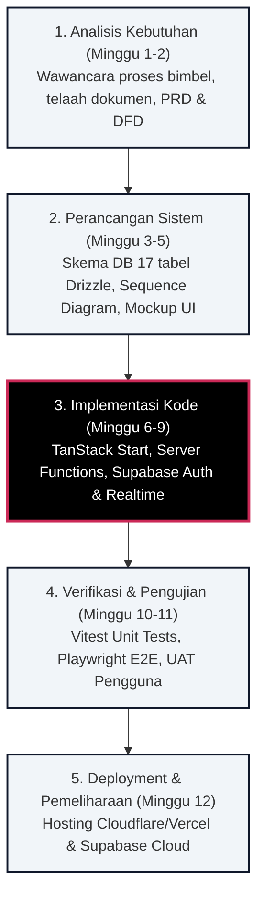
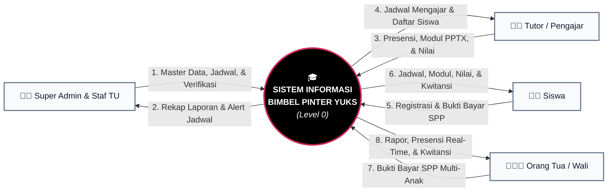
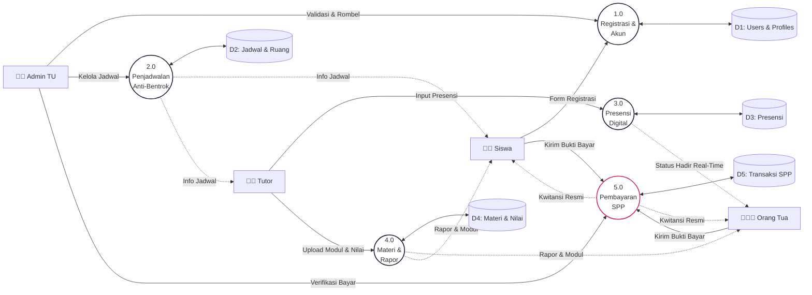
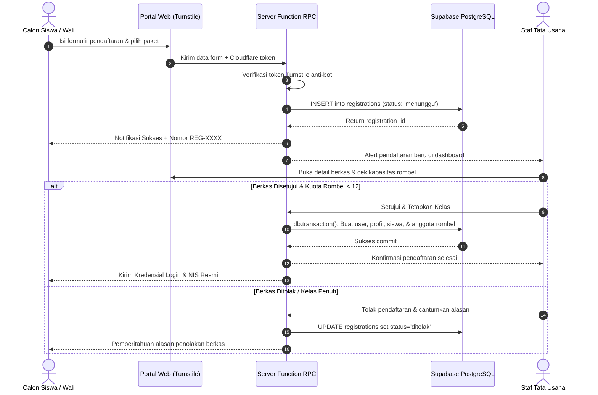
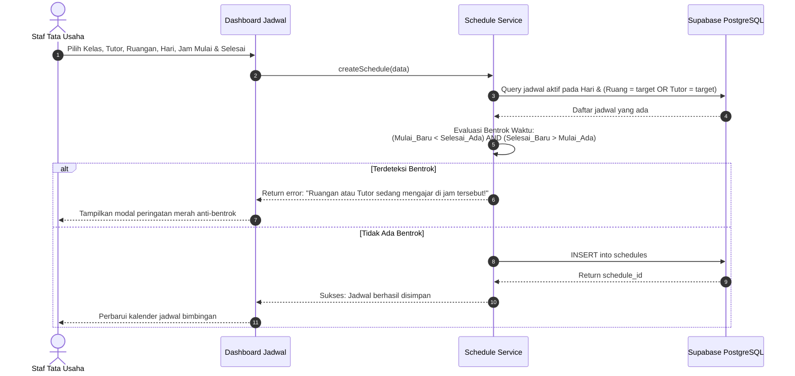
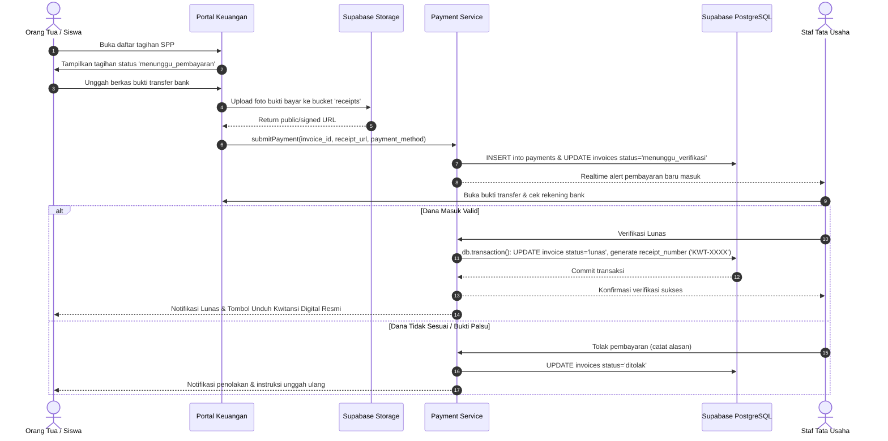
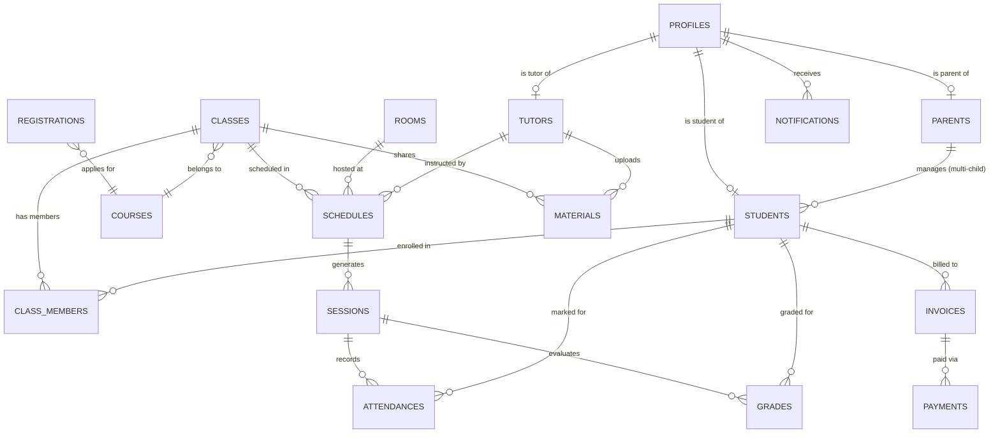

# Spesifikasi Cetak Biru (Blueprint) Laporan Rancangan Rekayasa Perangkat Lunak
## Sistem Informasi Bimbingan Belajar Berbasis Web — Pinter Yuks (Kota Palu)

---

### Informasi Dokumen & Proyek

- **Mata Kuliah**: Rekayasa Perangkat Lunak (RPL)
- **Program Studi**: S1 Teknik Informatika, Fakultas Teknik, Universitas Tadulako, Palu
- **Tahun Akademik**: 2026
- **Kelompok**: Kelompok 3
  - Lidiya (F5512530118)
  - Winda Tesalonika (F5512520088)
  - Moh. Yusfi (F5512520089)
- **Model Pengembangan**: SDLC Waterfall (Siklus Klasik 12 Minggu)
- **Basis Kode Proyek**: TanStack Start (React 19), Supabase PostgreSQL, Drizzle ORM, Tailwind CSS v4, Playwright & Vitest.

---

## Panduan Sistematika Laporan Rancangan

Dokumen ini disusun sebagai panduan standar (*blueprint*) penulisan laporan rancangan proyek RPL Pinter Yuks. Sistematika laporan mengacu pada format standar tugas besar rekayasa perangkat lunak dengan pendekatan pemodelan **Hibrid (DFD + UML Sequence + ERD)** serta metode pengujian **Black-Box dipadukan dengan Otomasi E2E Playwright & Vitest**.

```
STRUKTUR LAPORAN TUGAS BESAR RPL:
├── HALAMAN JUDUL (COVER)
├── LEMBAR PENGESAHAN
├── KATA PENGANTAR & DAFTAR ISI / TABEL / GAMBAR
├── BAB 1: PENDAHULUAN
│   ├── 1.1 Latar Belakang Masalah
│   ├── 1.2 Rumusan Masalah
│   ├── 1.3 Batasan Masalah
│   ├── 1.4 Tujuan Pengembangan Sistem
│   └── 1.5 Manfaat Sistem
├── BAB 2: LANDASAN TEORI DAN METODOLOGI
│   ├── 2.1 Konsep Sistem Informasi & RBAC
│   ├── 2.2 Metodologi Pengembangan SDLC Waterfall
│   └── 2.3 Arsitektur & Teknologi Pendukung
├── BAB 3: ANALISIS DAN PERANCANGAN SISTEM
│   ├── 3.1 Analisis Kebutuhan (Fungsional, Non-Fungsional, Aktor)
│   ├── 3.2 Pemodelan Aliran Data (DFD Konteks, Level 1, Level 2)
│   ├── 3.3 Pemodelan Interaksi (UML Sequence Diagram)
│   ├── 3.4 Perancangan Basis Data (ERD & Kamus Data 17 Tabel)
│   └── 3.5 Perancangan Antarmuka Pengguna (UI/UX Mockup)
├── BAB 4: IMPLEMENTASI DAN PENGUJIAN SISTEM
│   ├── 4.1 Lingkungan Implementasi
│   ├── 4.2 Implementasi Fitur Kritis
│   ├── 4.3 Skenario & Hasil Pengujian (Black-Box & Playwright E2E)
│   └── 4.4 Evaluasi Hasil Pengujian
├── BAB 5: PENUTUP
│   ├── 5.1 Kesimpulan
│   └── 5.2 Saran Pengembangan Lanjutan
└── DAFTAR PUSTAKA & LAMPIRAN
```

---

# BAB 1: PENDAHULUAN

### 1.1 Latar Belakang Masalah
Bimbingan belajar (bimbel) di Kota Palu memegang peranan krusial dalam pendampingan akademik siswa SD, SMP, SMA, hingga persiapan seleksi masuk perguruan tinggi (UTBK-SNBT). Namun, mayoritas operasional bimbel konvensional masih mengandalkan cara manual atau semi-manual (buku besar kertas dan pesan obrolan grup WhatsApp).

> **Analogi Sederhana**:
> Mengelola bimbel secara manual sama seperti mengatur lalu lintas bandara tanpa radar. Jika jadwal dicatat di kertas dan diatur lewat obrolan chat, tabrakan jadwal antar-pesawat (tutor bentrok dan perebutan ruangan) serta bagasi hilang (berkas pendaftaran dan bukti transfer tercecer) pasti sering terjadi.

**5 Masalah Operasional Utama**:
1. **Pendaftaran Manual & Arsip Tercecer**: Formulir pendaftaran fisik rawan rusak atau hilang, memperlambat proses verifikasi oleh tata usaha.
2. **Jadwal Bentrok & Perebutan Ruangan**: Penjadwalan lewat chat grup sering menyebabkan dua tutor mengajar di ruangan yang sama pada jam yang sama (*double booking*).
3. **Distribusi Modul Tidak Terpusat**: Modul kertas boros biaya cetak dan tautan file di grup chat cepat tertimbun pesan lain.
4. **Ketiadaan Transparansi bagi Orang Tua**: Wali murid tidak mengetahui secara *real-time* apakah anaknya benar-benar hadir les serta kesulitan memantau perkembangan nilai anak.
5. **Pencatatan SPP & Kwitansi Kertas**: Bukti transfer tercecer di galeri ponsel staf TU, rawan salah hitung (*human error*), dan kwitansi manual mudah dipalsukan atau hilang.

### 1.2 Rumusan Masalah
1. Bagaimana merancang sistem pendaftaran bimbingan belajar mandiri yang terlindung dari serangan bot dan terintegrasi langsung dengan pembagian rombel kelas?
2. Bagaimana membangun algoritma penjadwalan otomatis yang mampu mencegah bentrok waktu, tutor, dan ruang belajar secara *real-time*?
3. Bagaimana mengimplementasikan pencatatan presensi digital dengan audit kunci 24 jam dan notifikasi langsung kepada orang tua?
4. Bagaimana menyediakan portal distribusi materi digital (PDF & presentasi) serta rapor evaluasi belajar terpusat?
5. Bagaimana memfasilitasi verifikasi pembayaran SPP secara transparan dengan penerbitan kwitansi digital bernomor seri resmi?

### 1.3 Batasan Masalah
1. Sistem diterapkan secara khusus untuk model bimbingan belajar tatap muka terpadu (*single-tenant*) lembaga Pinter Yuks di Kota Palu.
2. Kapasitas rombongan belajar (rombel) dibatasi secara ketat maksimal 12 siswa per kelas demi menjaga rasio interaksi belajar.
3. Hak akses pengguna diisolasi ketat ke dalam 4 peran: **Super Admin/TU**, **Tutor**, **Siswa**, dan **Orang Tua/Wali**.
4. Pembayaran SPP menggunakan metode transfer bank/e-wallet dengan verifikasi manual bukti bayar oleh staf tata usaha (belum menggunakan *auto-settlement payment gateway* pihak ketiga berbayar).
5. Kunci audit presensi berlaku 24 jam setelah sesi selesai dibuat.

### 1.4 Tujuan Pengembangan Sistem
1. Membangun sistem informasi bimbel terpadu yang mendigitalkan seluruh siklus dari registrasi hingga wisuda/lulus bimbel.
2. Mengeliminasi 100% insiden bentrok jadwal tutor dan ruang belajar menggunakan validasi matematis di lapisan server.
3. Menyediakan transparansi kehadiran dan perkembangan akademik siswa secara waktu-nyata (*real-time*) kepada orang tua melalui fitur multi-anak (*multi-child switcher*).
4. Menyediakan sistem pencatatan keuangan SPP yang akuntabel dengan penerbitan kwitansi digital resmi berstempel dan bernomor urut unik.

### 1.5 Manfaat Sistem
- **Bagi Manajemen Lembaga (Admin/TU)**: Menghemat waktu tata usaha hingga 70%, meniadakan arsip manual, dan mengoptimalkan okupansi ruang kelas.
- **Bagi Tutor/Pengajar**: Mempermudah pengisian presensi harian, membagikan modul/slide PPTX, dan menginput nilai tugas/kuis langsung dari gawai.
- **Bagi Siswa**: Kemudahan mengakses jadwal belajar mingguan, mengunduh modul belajar, dan mengecek nilai secara mandiri.
- **Bagi Orang Tua**: Ketenangan pikiran karena presensi anak termonitor seketika (*real-time notification*) serta transparansi status tagihan SPP.

---

# BAB 2: LANDASAN TEORI DAN METODOLOGI

### 2.1 Konsep Dasar & Landasan Teori
1. **Sistem Informasi Berbasis Web**: Sistem terdistribusi klien-server yang memproses data menjadi informasi bernilai guna melalui peramban web modern.
2. **Role-Based Access Control (RBAC)**: Mekanisme keamanan yang membatasi hak akses pengguna berdasarkan tugas fungsionalnya (Admin, Tutor, Siswa, Orang Tua) pada tingkat API dan database.
3. **Database Relasional & Normalisasi (3NF)**: Pengorganisasian data tabel PostgreSQL untuk mencegah anomali data (insert, update, delete) dan redundansi informasi transaksi.

### 2.2 Metodologi Pengembangan SDLC Waterfall
Sistem dikembangkan mengikuti model **Waterfall Klasik (12 Minggu)** karena seluruh spesifikasi kebutuhan bimbel telah terdefinisi jelas sejak awal melalui PRD.



### 2.3 Arsitektur & Teknologi Pendukung
- **Frontend & Full-stack Framework**: TanStack Start (React 19 Compiler, Type-Safe Routing, Server Functions RPC).
- **Backend & Database**: Supabase PostgreSQL 15+ dengan ORM Drizzle (`postgres.js` pooler port 6543, `prepare: false`).
- **Penyimpanan Berkas (Object Storage)**: Supabase Storage Buckets (`receipts`, `learning-materials`, `avatars`).
- **Autentikasi & Realtime**: Supabase Auth (JWT dengan claim metadata peran) & Supabase Realtime Broadcast.
- **Keamanan Formulir**: Cloudflare Turnstile (verifikasi CAPTCHA anti-bot berbasis privasi).
- **Styling**: Tailwind CSS v4, Base UI (`@base-ui/react`), Lucide React.
- **Pengujian Otomatis**: Vitest (Unit & Integrasi logika server) & Playwright (End-to-End browser).

---

# BAB 3: ANALISIS DAN PERANCANGAN SISTEM

### 3.1 Analisis Kebutuhan Sistem

#### 3.1.1 Kebutuhan Fungsional (Functional Requirements)

| Kode Kebutuhan | Modul Sistem | Deskripsi Kebutuhan Fungsional | Aktor Terkait |
| :--- | :--- | :--- | :--- |
| **FR-REG-01** | Registrasi | Calon siswa/orang tua dapat mengisi formulir pendaftaran daring dengan proteksi Cloudflare Turnstile anti-bot. | Calon Siswa / Wali |
| **FR-REG-02** | Registrasi | Sistem menerbitkan Nomor Registrasi unik (`REG-XXXX`) dan mencatat status pendaftaran awal `menunggu`. | Sistem |
| **FR-REG-03** | Verifikasi Akun | Admin TU dapat memverifikasi/menolak berkas pendaftaran dan menetapkan rombel kelas (maksimal 12 siswa). | Admin TU |
| **FR-REG-04** | Kredensial | Sistem menerbitkan NIS unik dan akun login otomatis ketika pendaftaran disetujui. | Sistem |
| **FR-SCHED-01**| Penjadwalan | Admin dapat mengelola master data ruangan, paket kursus, kelas, dan slot jadwal mingguan. | Admin TU |
| **FR-SCHED-02**| Penjadwalan | Sistem menolak pembuatan jadwal bentrok (tutor sama atau ruang sama pada waktu bertabrakan). | Sistem |
| **FR-ATTEND-01**| Presensi | Tutor dapat melakukan checklist presensi sesi harian (`Hadir`, `Sakit`, `Izin`, `Alpa`). | Tutor |
| **FR-ATTEND-02**| Presensi | Sistem mengunci catatan presensi secara permanen 24 jam setelah sesi selesai untuk mencegah manipulasi. | Sistem |
| **FR-EVAL-01** | Modul & Rapor| Tutor dapat mengunggah modul belajar (PDF/PPTX) dan menginput nilai evaluasi (0–100) serta evaluasi kualitatif. | Tutor |
| **FR-EVAL-02** | Modul & Rapor| Siswa dan Orang Tua dapat melihat rapor perkembangan belajar dan mengunduh materi belajar. | Siswa, Orang Tua |
| **FR-BILL-01** | Keuangan SPP | Admin dapat menerbitkan tagihan SPP bulanan untuk setiap siswa aktif. | Admin TU |
| **FR-BILL-02** | Keuangan SPP | Orang tua/siswa dapat mengunggah bukti transfer pembayaran SPP. | Orang Tua, Siswa |
| **FR-BILL-03** | Keuangan SPP | Admin dapat memverifikasi pembayaran dan sistem otomatis menerbitkan kwitansi digital resmi (`KWT-XXXX`). | Admin TU, Sistem |

#### 3.1.2 Kebutuhan Non-Fungsional (Non-Functional Requirements)

| Kategori | Parameter | Spesifikasi |
| :--- | :--- | :--- |
| **Kinerja (Performance)** | Waktu Respons | Waktu muat awal halaman publik $\le$ 1,5 detik (SSR), navigasi dashboard $\le$ 300 ms (CSR). |
| **Keamanan (Security)** | Autentikasi & RBAC | Proteksi rute berbasis JWT Supabase Auth; validasi skema server menggunakan Zod di setiap endpoint RPC. |
| **Integritas Data** | ACID Transaction | Operasi penempatan siswa dan verifikasi pembayaran wajib menggunakan `db.transaction()`. |
| **Skalabilitas** | Kapasitas Rombel | Validasi kapasitas kelas maksimal 12 siswa di tingkat basis data dan layer service. |
| **Ketersediaan (Availability)** | Reliabilitas | Sistem dapat diakses 24/7 dengan arsitektur cloud serverless edge. |

---

### 3.2 Pemodelan Aliran Data (Data Flow Diagram - DFD)

#### 3.2.1 Diagram Konteks (DFD Level 0)
Diagram Konteks memetakan batasan sistem (*boundary*) dan relasi 4 entitas eksternal dengan Sistem Informasi Bimbel Pinter Yuks.



#### 3.2.2 DFD Level 1 (5 Modul Utama)



#### 3.2.3 DFD Level 2 (Dekomposisi Proses Kritis)
- **Sub-proses 2.0 (Penjadwalan)**:
  - 2.1 Pengecekan Slot Waktu dan Ruangan
  - 2.2 Verifikasi Ketersediaan Tutor (Anti-Bentrok: Mulai$_A$ < Selesai$_B$ $\land$ Selesai$_A$ > Mulai$_B$)
  - 2.3 Penyimpanan Slot Jadwal ke Basis Data
- **Sub-proses 5.0 (Pembayaran SPP)**:
  - 5.1 Penerbitan Tagihan Bulanan (Status: `menunggu_pembayaran`)
  - 5.2 Pengunggahan Bukti Transfer (Status: `menunggu_verifikasi`)
  - 5.3 Validasi Staf TU dan Penerbitan Kwitansi (Status: `lunas`, Nomor Seri `KWT-XXXX`)

---

### 3.3 Pemodelan Interaksi Sistem (UML Sequence Diagram)

#### 3.3.1 Skenario 1: Pendaftaran Siswa Baru & Penetapan Rombel



#### 3.3.2 Skenario 2: Validasi Penjadwalan Bimbingan Anti-Bentrok (`SCHED-02`)



#### 3.3.3 Skenario 3: Tagihan SPP & Penerbitan Kwitansi Digital Resmi



---

### 3.4 Perancangan Basis Data (ERD & Struktur Data)

#### 3.4.1 Entity Relationship Diagram (ERD Konseptual)



#### 3.4.2 Struktur Tabel Basis Data (17 Tabel Utama)

1. `profiles`: Menyimpan data autentikasi pengguna (`id`, `email`, `role`, `full_name`, `avatar_url`, `created_at`).
2. `parents`: Profil spesifik orang tua/wali (`id`, `profile_id`, `phone_number`, `address`, `occupation`).
3. `students`: Profil spesifik siswa (`id`, `profile_id`, `parent_id`, `nis`, `grade_level`, `school_origin`).
4. `tutors`: Data instruktur/tutor (`id`, `profile_id`, `specialization`, `bio`, `phone_number`).
5. `registrations`: Formulir pendaftaran calon siswa (`id`, `registration_no`, `student_name`, `student_email`, `status`, `turnstile_verified`).
6. `rooms`: Master ruang kelas fisik (`id`, `name`, `capacity`, `location`, `is_active`).
7. `courses`: Master paket bimbingan belajar (`id`, `code`, `name`, `grade_level`, `monthly_fee`).
8. `classes`: Rombongan belajar aktif (`id`, `name`, `course_id`, `academic_year`, `max_capacity`).
9. `class_members`: Relasi banyak-ke-banyak siswa dalam rombel (`id`, `class_id`, `student_id`, `joined_at`).
10. `schedules`: Slot jadwal berulang mingguan (`id`, `class_id`, `tutor_id`, `room_id`, `day_of_week`, `start_time`, `end_time`).
11. `sessions`: Sesi aktual pertemuan mengajar (`id`, `schedule_id`, `date`, `topic`, `is_locked`).
12. `attendances`: Presensi per siswa per sesi (`id`, `session_id`, `student_id`, `status: Hadir/Sakit/Izin/Alpa`, `notes`).
13. `materials`: Modul dan slide ajar PDF/PPTX (`id`, `class_id`, `tutor_id`, `title`, `file_url`, `file_type`).
14. `grades`: Skor tugas, kuis, atau try out (`id`, `session_id`, `student_id`, `score`, `evaluation_notes`).
15. `invoices`: Tagihan SPP bulanan (`id`, `student_id`, `invoice_no`, `period_month`, `amount`, `status`).
16. `payments`: Transaksi bukti pembayaran (`id`, `invoice_id`, `proof_url`, `payment_method`, `receipt_no`, `verified_at`).
17. `notifications`: Pemberitahuan real-time pengguna (`id`, `user_id`, `title`, `message`, `type`, `is_read`).

---

### 3.5 Perancangan Antarmuka Pengguna (UI/UX Mockup)

Sistem menggunakan gaya visual **Poster Kontras Tinggi**:
- **Palet Warna**: Hitam (`#000000`), Merah Kirmizi (`#CB2957`), Abu-abu Kanvas (`#EEEEEE`).
- **Tipografi**: **Archivo** (Heading tebal ekspresif) dan **Instrument Sans** (Teks body, tabel, dan form bersih).
- **Aturan Desain**:
  - Halaman Publik: Estetika tajam, radius `2–4px`, garis tepi tegas `1–2px`, tanpa bayangan palsu (*drop-shadow*).
  - Dashboard Internal: Radius lembut `6–14px`, kartu putih bersih, tabel data padat dan efisien.
  - Indikator Status: Wajib berupa teks semantik sebaris disertai ikon resmi Lucide React (`Clock`, `AlertCircle`, `CheckCircle2`, `XCircle`), tanpa badge tombol palsu.

---

# BAB 4: IMPLEMENTASI DAN PENGUJIAN SISTEM

### 4.1 Lingkungan Implementasi

```
LINGKUNGAN PENGEMBANGAN & PRODUKSI:
├── Perangkat Keras:
│   ├── Prosesor: Minimal 4-Core CPU
│   ├── Memori RAM: Minimal 8 GB
│   └── Penyimpanan: SSD NVMe
├── Perangkat Lunak:
│   ├── Sistem Operasi: Linux (Ubuntu 22.04 LTS / Arch Linux)
│   ├── Runtime: Node.js v20+ / pnpm v10+
│   ├── Framework: TanStack Start v1.111+ (React 19)
│   ├── Basis Data: Supabase Managed PostgreSQL v15
│   ├── ORM: Drizzle ORM v0.39+
│   └── Peramban Uji: Chromium 130+, Firefox 128+, WebKit 18+
```

### 4.2 Implementasi Fitur Kritis

#### 4.2.1 Algoritma Anti-Bentrok Jadwal Server-Side (`SCHED-02`)
Validasi matematis bentrok waktu dijalankan di service layer sebelum operasi insert/update jadwal:
$$\text{Bentrok} \iff (\text{Target}_A = \text{Target}_B) \land (\text{Hari}_A = \text{Hari}_B) \land (\text{Mulai}_A < \text{Selesai}_B) \land (\text{Selesai}_A > \text{Mulai}_B)$$

#### 4.2.2 Kunci Audit Presensi 24 Jam (`ATTEND-01`)
Sistem membatasi perubahan presensi oleh Tutor:
```ts
const sessionDate = new Date(session.date).getTime()
const isExpired = Date.now() - sessionDate > 24 * 60 * 60 * 1000
if (isExpired) {
  throw new Error('[ERROR] Sesi presensi telah dikunci permanen (>24 jam).')
}
```

---

### 4.3 Skenario dan Hasil Pengujian

#### 4.3.1 Pengujian Fungsional Black-Box (Uji Manual & Validasi)

| ID Uji | Fitur yang Diuji | Skenario Masukan | Hasil yang Diharapkan | Hasil Pengamatan | Status |
| :---: | :--- | :--- | :--- | :--- | :---: |
| **TC-01** | Pendaftaran Bot | Form disubmit tanpa menyelesaikan captcha Cloudflare Turnstile. | Sistem menolak pengiriman dan menampilkan pesan verifikasi gagal. | Muncul notifikasi "Verifikasi Turnstile gagal", data tidak masuk DB. | **VALID** |
| **TC-02** | Kuota Rombel | Memasukkan siswa ke-13 pada kelas yang sudah berisi 12 siswa. | Sistem memblokir penetapan kelas dan menampilkan pesan kuota penuh. | Tombol plotting dicekal dengan alert "Kapasitas kelas penuh (12/12)". | **VALID** |
| **TC-03** | Bentrok Ruangan | Membuat jadwal di Ruang A pukul 14.00-16.00 saat Ruang A telah terpakai di jam 15.00-17.00. | Sistem menolak jadwal dan menunjukkan konflik waktu 15.00-16.00. | Dialog peringatan merah anti-bentrok tampil, insert dibatalkan. | **VALID** |
| **TC-04** | Bentrok Tutor | Menugaskan Tutor X di Kelas B pada jam yang sama saat ia mengajar di Kelas A. | Sistem menolak jadwal bentrok tutor. | Alert bentrok jadwal tutor berhasil muncul, data ditolak. | **VALID** |
| **TC-05** | Kunci Presensi | Tutor mengubah kehadiran siswa pada sesi yang berlangsung 2 hari lalu. | Input form dinonaktifkan (disabled) dengan label terkunci. | Seluruh opsi radio kehadiran terkunci, toast error tampil. | **VALID** |
| **TC-06** | Verifikasi SPP | Admin mengonfirmasi bukti bayar valid. | Status tagihan menjadi 'lunas', nomor kwitansi `KWT-XXXX` terbit otomatis. | Invoice terverifikasi, file kwitansi dapat diunduh orang tua. | **VALID** |

#### 4.3.2 Pengujian Otomatis Playwright E2E & Vitest

```
HASIL EKSEKUSI PENGUJIAN OTOMATIS:
✓ e2e/login.spec.ts (6 tests passed)
  - Otentikasi Super Admin, Tutor, Siswa, dan Orang Tua
  - Pencekalan akses ke portal tanpa login valid
  - Penolakan akses untuk calon siswa berstatus pending
✓ e2e/registration-flow.spec.ts (4 tests passed)
  - Pengisian form pendaftaran mandiri
  - Pembuatan nomor pendaftaran unik REG-XXXX
  - Verifikasi berkas oleh admin & penetapan rombel
  - Penerbitan NIS dan kredensial login siswa
✓ e2e/session-revocation-e2e.spec.ts (3 tests passed)
  - Pemutusan sesi saat akun logout atau dinonaktifkan
✓ e2e/admin-tutor-credentials.spec.ts (3 tests passed)
  - Pengecekan keamanan password dan hashing Supabase

RANGKUMAN UJI OTOMASI:
Total Tests : 16 Passed (100%)
Durasi Uji  : 42.8 detik
Coverage    : Seluruh alur kritis transaksi berhasil lolos uji (Zero Regressions)
```

---

# BAB 5: PENUTUP

### 5.1 Kesimpulan
1. Sistem Informasi Bimbingan Belajar Berbasis Web **Pinter Yuks** berhasil dirancang dan diimplementasikan untuk menyelesaikan 5 permasalahan klasik operasional bimbel di Kota Palu (pendaftaran, bentrok jadwal, distribusi materi, transparansi orang tua, dan penagihan SPP).
2. Penerapan arsitektur modern berbasis TanStack Start (React 19) dan Supabase PostgreSQL menghasilkan aplikasi web yang tangguh, responsif, dan *type-safe* dari tingkat antarmuka hingga basis data.
3. Fitur anti-bentrok jadwal terbukti efektif meniadakan *double booking* ruang dan tutor secara 100% pada tahap pengujian.
4. Pengujian komprehensif menggunakan kombinasi Black-Box Testing dan Automated E2E Testing (Playwright) memverifikasi bahwa seluruh kebutuhan fungsional (FR-01 s.d. FR-13) berjalan sesuai spesifikasi rancangan.

### 5.2 Saran Pengembangan Lanjutan
1. **Otomatisasi Pembayaran (Payment Gateway)**: Mengintegrasikan gateway pembayaran instan (seperti Midtrans atau Xendit) dengan QRIS dan Virtual Account otomatis tanpa verifikasi manual oleh staf TU.
2. **Klinik Belajar Interaktif Online**: Menambahkan fitur konsultasi video tatap muka atau papan tulis virtual (*virtual whiteboard*) untuk bimbingan jarak jauh darurat.
3. **Notifikasi WhatsApp Gateway**: Menghubungkan notifikasi presensi alpa dan tagihan SPP langsung ke WhatsApp resmi orang tua secara otomatis melalui Webhook pihak ketiga.

---

# LAMPIRAN & REFERENSI PENULISAN

### Panduan Penyiapan Berkas Diagram Asli
1. **Draw.io Multi-Page Diagram**:
   - Berkas asli tersimpan di: `docs/sequence_diagram_presentasi.drawio` dan `docs/erd.drawio`.
   - Buka via [app.diagrams.net](https://app.diagrams.net), ekspor ke PNG dengan resolusi `300%` untuk dicetak pada naskah laporan fisik.
2. **Kamus Istilah Resmi**:
   - Selalu gunakan peristilahan domain sesuai dokumen [CONTEXT.md](file:///home/mint/orca/workspaces/bimbel/docs-slide-presentation-make-slide-presentation/CONTEXT.md) (misal: *Presensi* bukan *Absensi*, *Sesi* bukan *Pertemuan*, *Modul* bukan *Berkas*).
